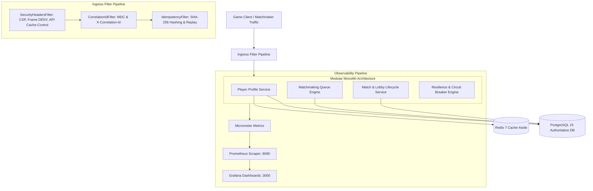
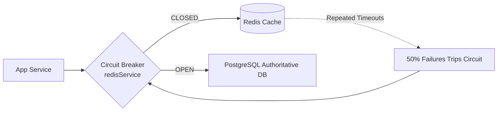

# GamePulse — Chaos-Resilient Gameplay Services Platform

[](https://github.com/rohith-chitturi/GamePulse/actions/workflows/ci.yml)
[](https://www.oracle.com/java/)
[](https://spring.io/projects/spring-boot)
[](https://www.postgresql.org/)
[](https://redis.io/)
[](https://prometheus.io/)
[](https://grafana.com/)
[](LICENSE)

> **Notice**: GamePulse is an independent portfolio project engineered to demonstrate production-grade distributed backend architecture, concurrency guarantees, fault isolation, and load-tested scalability for online multiplayer games.

---

## 1. System Overview & Architecture

Modern multiplayer backends face extreme concurrency challenges: network retries causing duplicate purchases or ticket issuances, race conditions breaching lobby capacities, cascading failures from external analytics timeouts, and database connection pool starvation under traffic spikes.

**GamePulse** is an enterprise-grade gameplay services platform simulating competitive online multiplayer matchmaking, player profile management, and authoritative game lobby lifecycles.



---

## 2. Technology Stack & Component Inventory

| Layer | Technology | Version | Purpose |
| :--- | :--- | :--- | :--- |
| **Runtime** | Java LTS | 17.0.12 | Strongly typed, modern enterprise runtime |
| **Framework** | Spring Boot | 3.3.5 | Core inversion-of-control, Web MVC, and lifecycle orchestration |
| **Authoritative DB** | PostgreSQL | 15-Alpine | ACID transactional persistence with row-level locks |
| **Distributed Cache** | Redis | 7-Alpine | High-speed cache-aside layer with auto-degradation |
| **Resilience** | Resilience4j | 2.2.0 | Circuit breakers, bounded exponential retries, rate limits |
| **Telemetry** | Micrometer & Prometheus | 2.54.1 | Custom dimensional metrics and 5s pull-model scraping |
| **Dashboards** | Grafana | 11.2.0 | Real-time connection pool, circuit breaker, and latency dashboards |
| **Load Testing** | Grafana k6 | 2.3.0 | Multi-scenario concurrency benchmarking engine |
| **Containerization** | Docker & Compose | v29 / v5 | Isolated 5-service container deployment topology |

---

## 3. Core Gameplay Subsystems

### 3.1 Player Profile Service (`com.gamepulse.player`)
- **Authoritative Identity**: Manages player registration, MMR matchmaking ratings, and player lifecycle states (`ONLINE`, `IN_QUEUE`, `IN_MATCH`, `OFFLINE`).
- **Resilient Cache-Aside**:
  - Hot reads query Redis (`player:{id}`).
  - If Redis times out (> 2000ms) or is unreachable, requests degrade to PostgreSQL automatically with zero user impact.
  - Profile updates perform atomic database writes and cache invalidations.

### 3.2 Deterministic Matchmaking Service (`com.gamepulse.matchmaking`)
- **Fair FIFO Queuing**: Ingress players are queued with baseline MMR search windows.
- **Dynamic Tolerance Expansion**: Ticket wait duration expands search tolerance dynamically (`baseTolerance = 100`, `expansionRate = 5 MMR/sec`, `maxTolerance = 1000`).
- **Candidate Detachment**: Queries decouple candidate tickets from Hibernate persistence contexts before evaluation to eliminate stale version collisions under concurrent sweeps.

### 3.3 Authoritative Lobby & Session Service (`com.gamepulse.session`)
- **Session State Machine**: Governs deterministic transitions:
  $$\text{WAITING\_FOR\_PLAYERS} \longrightarrow \text{IN\_PROGRESS} \longrightarrow \text{COMPLETED} \text{ / } \text{CANCELLED}$$
- **Capacity Boundaries**: Enforces strict player capacity limits (`maxPlayers`) using pessimistic row locking.

---

## 4. Concurrency Guarantees & Transaction Isolation

Multi-user gameplay backends cannot tolerate overfilled matches or duplicate matchmaker claims. GamePulse enforces mathematical invariants at the database layer:

| Domain Invariant | Threat Vector | Isolation Mechanism | Verified Guarantee |
| :--- | :--- | :--- | :--- |
| **Lobby Capacity** | Parallel burst of players joining a nearly full lobby | `PESSIMISTIC_WRITE` row lock on `MatchSession` | Active roster count strictly never exceeds `maxPlayers`. Verified with 200 concurrent VUs. |
| **Queue Uniqueness** | Rapid double-click or network duplicate enqueue | Status check under row lock | A player can have at most one active `QUEUED` ticket across the system. |
| **Ticket Claiming** | Two matchmaker sweeps selecting the same player | Atomic multi-row locking via `findByIdsWithLock` | A ticket cannot transition to `MATCHED` more than once; double assignment is impossible. |
| **Detached Persistence** | Stale Hibernate entity flush conflicts | Explicit `EntityManager.detach()` on candidates | Eliminates `ObjectOptimisticLockingFailureException` during concurrent matchmaking flushes. |

---

## 5. Strong Application-Level Idempotency

Mutating gameplay operations (`POST /api/v1/players`, `/matchmaking/queue`, `/matches/lobbies`, `/complete`) support application-level idempotency via the `Idempotency-Key` HTTP header.

1. **SHA-256 Payload Fingerprinting**: Computes a cryptographic digest of the incoming request body and URI path.
2. **Atomic Ingress Lease**: Attempts to insert an `IdempotencyRecord` with status `PROCESSING`.
   - **Concurrent Duplicate**: Returns HTTP 409 `CONCURRENT_IDEMPOTENT_REQUEST`.
   - **Mismatched Payload Hash**: Returns HTTP 422 `CONFLICTING_IDEMPOTENCY_KEY`.
3. **Transparent Cached Replay**: On first successful completion, stores the HTTP status code and response payload. Subsequent identical retries replay the cached response immediately with `Idempotency-Replayed: true` header.

---

## 6. Resilience Engineering & Failure Testing



1. **Circuit Breaker Isolation (`Resilience4j`)**:
   - `redisService`: Bounded sliding window (5 calls, 50% threshold). Automatically trips to OPEN if Redis fails, preventing thread starvation.
   - `downstreamService`: Protects match completion notifications from third-party analytics latency.
2. **Bounded Exponential Retries**:
   - Database deadlocks and transient socket errors are retried up to 3 times with exponential backoff (100ms multiplier). Non-idempotent operations are never blindly retried.
3. **Controlled Chaos Surface**:
   - Simulation endpoints allow empirical failure testing in staging.
   - Protected in production by `gamepulse.chaos.enabled=false`, returning HTTP 403 `CHAOS_DISABLED`.

---

## 7. Load Testing & Empirical Performance Benchmarks

Performance characterization was conducted using **Grafana k6** running against the live multi-container Docker Compose infrastructure:

| Workload Profile | Virtual Users (VUs) | Duration | Total Requests | Throughput (RPS) | Average Latency | p95 Latency | Profile Read p95 | Unexpected HTTP Errors |
| :--- | :---: | :---: | :---: | :---: | :---: | :---: | :---: | :---: |
| **Baseline** | 25 | 2m | 25,002 | 207.78 req/s | 62.80 ms | 205.19 ms | 45.55 ms | **0.00%** |
| **Moderate** | 50 | 3m | 46,370 | 257.55 req/s | 124.68 ms | 389.50 ms | 123.00 ms | **0.00%** |
| **High** | 100 | 3m | 47,336 | 262.60 req/s | 281.61 ms | 871.72 ms | 465.00 ms | **0.00%** |

### Key Scalability Finding: The 100 VU Throughput Plateau

> **Architecture Deep Dive**: At 100 concurrent VUs, throughput plateaus at **262.60 req/s** (virtually identical to 50 VUs at 257.55 req/s).  
> **Root Cause**: The HikariCP database connection pool is configured to a ceiling of 25 connections (`HIKARI_MAX_POOL_SIZE: 25`). Under 100 concurrent threads executing mixed ACID write transactions, all 25 connections remain continuously saturated. Request threads queue in memory waiting for available connections, cleanly shifting throughput gains into queued latency (p95 increases to 871.72ms).  
> **Reliability Outcome**: Despite saturation, GamePulse demonstrated **100% stability**: zero connection timeouts, zero connection leaks, zero unhandled 500 errors, and zero data corruption across 47,336 requests.  
> **Scaling Path**: Scaling beyond 260 req/s requires either vertical pool expansion (scaling PostgreSQL compute and HikariCP pool to 50-75 connections) or horizontal read replica routing for player profile reads.

---

## 8. Production Security Hardening & Threat Model

1. **Zero Hardcoded Secrets**: All credentials and sensitive ports are externalized via environment variables. A safe `.env.example` template provides placeholder configurations.
2. **Strict CORS Policy**: Avoids wildcard `*` origins in production; origins are restricted to configured hosts via `CORS_ALLOWED_ORIGINS`.
3. **HTTP Security Headers**: Enforces defense-in-depth on all responses:
   - `X-Content-Type-Options: nosniff`
   - `X-Frame-Options: DENY`
   - `X-XSS-Protection: 0`
   - `Referrer-Policy: strict-origin-when-cross-origin`
   - `Permissions-Policy: geolocation=(), camera=(), microphone=()`
   - `Content-Security-Policy: default-src 'self'; frame-ancestors 'none'`
4. **Dynamic API Cache Prevention**: Enforces `Cache-Control: no-cache, no-store, max-age=0, must-revalidate` on all `/api/*` routes to protect transient gameplay state from intermediary caches.
5. **Actuator Lockdown**: Internal inspection tools are restricted to `health,info,prometheus,metrics`. Health details in production require authentication (`when-authorized`).
6. **Chaos Protection**: Fault injection controls return HTTP 403 `CHAOS_DISABLED` when `gamepulse.chaos.enabled=false`.

---

## 9. Multi-Container Infrastructure (Docker Compose)

Deploy the complete multi-service stack with a single command:

```bash
# 1. Prepare environment variables
cp .env.example .env

# 2. Launch production stack
docker compose up -d

# 3. Verify container health
docker compose ps
```

| Service | Container Name | Port Mapping | Health Check Mechanism |
| :--- | :--- | :--- | :--- |
| **gamepulse-app** | `gamepulse-app` | `8080:8080` | `curl -f http://localhost:8080/actuator/health` |
| **postgres** | `gamepulse-postgres` | `5433:5432` | `pg_isready -U gamepulse -d gamepulsedb` |
| **redis** | `gamepulse-redis` | `6381:6379` | `redis-cli ping` |
| **prometheus** | `gamepulse-prometheus` | `9090:9090` | `wget -q --spider http://localhost:9090/-/healthy` |
| **grafana** | `gamepulse-grafana` | `3000:3000` | `wget -q --spider http://localhost:3000/api/health` |

---

## 10. Interactive API Documentation

Interactive Swagger UI and OpenAPI 3.0 documentation are automatically served by the application:
- **Swagger UI**: [http://localhost:8080/swagger-ui/index.html](http://localhost:8080/swagger-ui/index.html)
- **OpenAPI Schema**: [http://localhost:8080/v3/api-docs](http://localhost:8080/v3/api-docs)

### Core REST Endpoints

| Method | Endpoint | Description | Idempotency Supported |
| :--- | :--- | :--- | :---: |
| `POST` | `/api/v1/players` | Create player profile | Yes |
| `GET` | `/api/v1/players/{id}` | Read player profile (cache-aside) | No (Idempotent GET) |
| `POST` | `/api/v1/matchmaking/queue` | Enqueue player for matchmaking | Yes |
| `GET` | `/api/v1/matchmaking/tickets/{id}` | Query ticket status | No (Idempotent GET) |
| `POST` | `/api/v1/matches/lobbies` | Create authoritative match lobby | Yes |
| `POST` | `/api/v1/matches/{id}/join` | Join lobby slot (pessimistic lock) | No |
| `POST` | `/api/v1/matches/{id}/start` | Start match session | Yes |
| `POST` | `/api/v1/matches/{id}/complete` | Complete match and record winner | Yes |
| `GET` | `/api/v1/resilience/status` | Real-time circuit breaker status | No |

---

## 11. Operational Monitoring & Grafana Dashboards

Pre-provisioned dashboards are available in Grafana ([http://localhost:3000](http://localhost:3000)):
- **HikariCP Connection Pool Saturation**: Real-time graphs of active, idle, pending, and max connections.
- **Resilience4j Circuit Breakers**: Live status tracking for `downstreamService` and `redisService` (0 = Closed, 1 = Open, 2 = Half-Open).
- **HTTP Request Latency & Throughput**: p50, p90, p95, p99 request duration breakdown by route.
- **JVM Memory & GC Metrics**: Garbage collection pauses and heap allocation.

---

## 12. Quality Gate & Automated Testing

GamePulse enforces rigorous automated quality gates on every Pull Request via GitHub Actions:

```bash
# Execute complete automated test suite (56 tests)
.\mvnw.cmd clean test

# Execute targeted concurrency & idempotency integration tests
.\mvnw.cmd test "-Dtest=ConcurrencyIntegrationTest,IdempotencyIntegrationTest"

# Execute resilience & security validation tests
.\mvnw.cmd test "-Dtest=SecurityAndChaosProtectionIntegrationTest,ResilienceIntegrationTest"
```

### Test Suite Structure
- **Unit Tests**: Mockito tests verifying isolated business rules and DTO validations.
- **Integration Tests**: Spring Boot `@SpringBootTest` suites testing JPA transaction rollbacks and MVC responses.
- **Concurrency Integration Tests**: Multi-threaded ExecutorService tests hammering lobby capacity and queue deduplication.
- **Resilience Tests**: Chaos injection verifying circuit breaker transitions, retries, and fallback invocations.
- **Security Tests**: Verifying HTTP security headers, dynamic cache prevention, and 403 `CHAOS_DISABLED` enforcement.

---

## 13. Live Demonstration Script

A non-destructive PowerShell verification script is provided to demonstrate all architectural invariants against the live Docker stack:

```powershell
# Run the live technical demonstration
.\scripts\demo.ps1
```

The script executes:
1. Docker infrastructure & container health probe validation.
2. Player profile creation and Redis cache-aside read verification.
3. Deterministic matchmaking enqueue and ticket lifecycle validation.
4. Idempotency assertion: Submits lobby creation twice with identical `Idempotency-Key` and validates exact response match with `Idempotency-Replayed: true`.
5. Concurrency enforcement: Joins two players to fill a 2-player lobby, attempts to join a 3rd player, and asserts HTTP 409 `CAPACITY_EXCEEDED`.
6. Match state transition: Starts and completes the match session, asserting winner recording.
7. Security surface gating: Probes mutating chaos endpoints and asserts HTTP 403 `CHAOS_DISABLED`.

---

## 14. Project Documentation Index

- [Technical Architecture Specification](docs/architecture/ARCHITECTURE.md)
- [Operations & Incident Response Runbook](docs/OPERATIONS_RUNBOOK.md)
- [Security Review & Threat Model](docs/SECURITY_REVIEW.md)
- [Performance Benchmark & Scalability Report](docs/PERFORMANCE_BENCHMARK_REPORT.md)
- [Empirical Resilience & Chaos Test Report](docs/RESILIENCE_TEST_REPORT.md)
- [Concurrency & Idempotency Specification](docs/architecture/CONCURRENCY_AND_IDEMPOTENCY.md)

---

## License

This project is licensed under the MIT License — see the [LICENSE](LICENSE) file for details.
