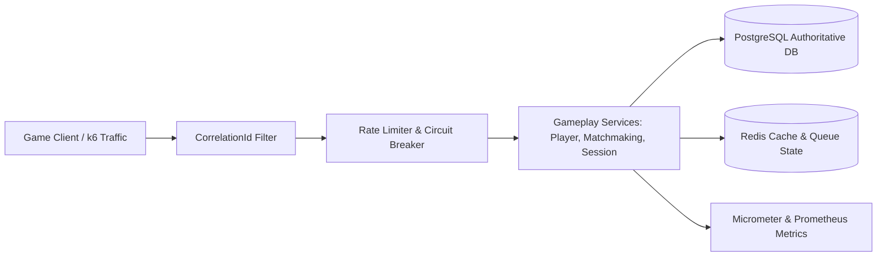

# GamePulse: Chaos-Resilient Gameplay Services Platform

[](https://github.com/rohith-chitturi/GamePulse/actions/workflows/ci.yml)
[](LICENSE)
[](https://www.oracle.com/java/)
[](https://spring.io/projects/spring-boot)

**GamePulse** is a production-grade, distributed gameplay services platform developed as an engineering showcase for the **Electronic Arts Software Engineering / DevOps Internship**.

The platform simulates the core backend infrastructure supporting real-time multiplayer titles (e.g., EA SPORTS FC, Apex Legends, Battlefield) — including player profiles, deterministic matchmaking queues, lobby management, match lifecycle sessions, and reliability engineering controls.

---

## 1. Project Vision & Research Question

> **Can we demonstrate, with repeatable experiments, how backend reliability engineering protects a multiplayer gaming service when dependencies fail or traffic increases?**

GamePulse addresses this question through an **experimentally verified reliability workflow**:
1. **Establish Baseline**: Measure throughput, error rate, and latency (p50/p95/p99) under normal traffic.
2. **Inject Controlled Failure**: Simulate dependency timeouts, packet loss, or database degradation.
3. **Observe Impact**: Correlate symptoms using Prometheus metrics, Grafana dashboards, and structured MDC logs with request correlation IDs.
4. **Apply Engineering Fix**: Introduce circuit breakers (Resilience4j), rate limiters, idempotent transactions, and safe exponential retries with jitter.
5. **Verify & Compare**: Re-run identical load scenarios with k6 and publish empirical before-and-after measurements.

---

## 2. Architecture & Domain Partitioning

GamePulse is implemented as a clean **modular monolith** with explicit domain boundaries:

```
src/main/java/com/ea/gamepulse/
├── core/            # Infrastructure: CorrelationId filter, global exception handling, response wrappers
├── player/          # Player profiles, ratings, registration, validations
├── matchmaking/     # FIFO matchmaking queue, windowed MMR matching, ticket lifecycle
├── session/         # Lobbies, match sessions, state machines, roster validation
├── reliability/     # Circuit breakers, rate limiters, idempotency, controlled fault injection
└── telemetry/       # Micrometer metrics, Prometheus scrapers, health indicators
```



---

## 3. Technology Stack

- **Backend**: Java 17 LTS, Spring Boot 3.3.5, Spring Web, Spring Data JPA, Spring Validation
- **Persistence**: PostgreSQL (production), H2 (in-memory test profile)
- **Caching & Coordination**: Redis
- **Resilience**: Resilience4j (Circuit Breakers, Bulkheads, Rate Limiters, Timeouts)
- **Observability**: Spring Boot Actuator, Micrometer, Prometheus, Grafana, SLF4J MDC Tracing
- **Testing**: JUnit 5, Mockito, Spring Boot Test, Testcontainers, k6 Load Tests
- **DevOps**: Docker, Docker Compose, GitHub Actions, CodeRabbit

---

## 4. Getting Started

### Prerequisites
- **Java**: JDK 17 LTS or higher
- **Maven**: 3.9+ (or use the included `./mvnw` wrapper)
- **Docker**: Optional for local containerized databases and Grafana stack

### Build and Run Tests
Clone the repository and run the test suite:
```bash
# Clone the repository
git clone https://github.com/rohith-chitturi/GamePulse.git
cd GamePulse

# Run tests via Maven Wrapper
./mvnw clean test

# Windows PowerShell:
.\mvnw.cmd clean test
```

### Run Locally
```bash
./mvnw spring-boot:run
```
The application will start on port `8080`.

### Key Endpoints (Phase 0 Baseline)
- `GET /api/v1/system/info` — Service metadata, status, version, and active profile
- `GET /actuator/health` — Spring Boot Actuator liveness & readiness probes
- `GET /actuator/prometheus` — Prometheus metric scraping endpoint

---

## 5. Engineering Standards & Pull Request Workflow

Every phase of GamePulse is developed and reviewed strictly through GitHub Pull Requests:
`Inspect → Plan → Implement → Test → Review → Commit → Push → Open PR → CodeRabbit Review → Fix Findings → Recheck → Merge`.

Refer to [`PROJECT_PLAN.md`](PROJECT_PLAN.md) for the active roadmap, phase completion criteria, and experiment logs.
