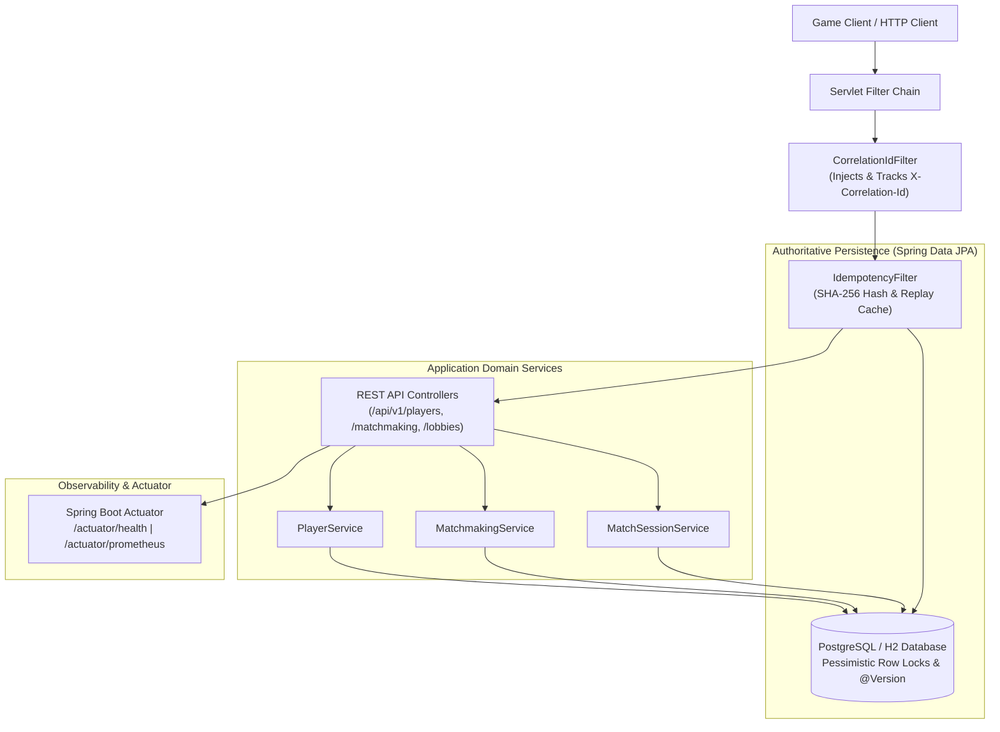

# GamePulse — Gameplay Services Platform

[](https://github.com/rohith-chitturi/GamePulse/actions/workflows/ci.yml)
[](https://www.oracle.com/java/)
[](https://spring.io/projects/spring-boot)
[](https://maven.apache.org/)
[](LICENSE)

> A production-minded, distributed gameplay services platform built with Java 17 and Spring Boot 3, demonstrating backend correctness, deterministic matchmaking, authoritative lobby/session state lifecycles, application-level idempotency, and database concurrency controls.

---

## 1. Project Overview

Online multiplayer gameplay backends face demanding data integrity challenges under bursty traffic and erratic client networks. Dropped network packets cause clients to retry mutating requests, rapid user actions trigger race conditions at lobby capacity boundaries, and concurrent matchmakers risk assigning players to multiple matches simultaneously.

**GamePulse** addresses these challenges through a modular, transactional backend that enforces strict domain invariants:
- **Player Profile Management**: Authoritative player profiles, MMR matchmaking ratings, and status tracking (`ONLINE`, `IN_QUEUE`, `IN_MATCH`, `OFFLINE`).
- **Deterministic Matchmaking**: Fair FIFO queuing with expanding MMR tolerance windows and atomic candidate-pair claiming.
- **Lobby & Match Session Lifecycle**: Authoritative session state machines (`INITIALIZING` $\rightarrow$ `WAITING_FOR_PLAYERS` $\rightarrow$ `IN_PROGRESS` $\rightarrow$ `COMPLETED` / `CANCELLED`) with serialized roster admission.
- **Application-Level Idempotency**: Transparent caching and replay for mutating requests using client-provided `Idempotency-Key` headers and SHA-256 payload fingerprinting.
- **Database Concurrency Controls**: Pessimistic row-level locking (`SELECT ... FOR UPDATE`) paired with optimistic entity versioning (`@Version`) to guarantee zero over-capacity lobbies or double queue entries.
- **Automated Verification**: End-to-end multi-threaded concurrency suites, Testcontainers integration tests, and GitHub Actions continuous integration.

---

## 2. Engineering Challenges Solved

| Challenge | Failure Mode Prevented | Engineering Solution | Invariant Guaranteed |
| :--- | :--- | :--- | :--- |
| **Lobby Overfill** | Parallel join bursts breach `maxPlayers` limit | `PESSIMISTIC_WRITE` row lock on `MatchSession` | Active roster count strictly never exceeds `maxPlayers` under parallel bursts. |
| **Duplicate Queue Entries** | Simultaneous enqueue requests produce redundant tickets | Row lock on `Player` + status check | A player can have at most one active `QUEUED` ticket across the system. |
| **Double Matchmaking** | Two matchmaker sweeps pair the same player into two matches | Multi-row atomic ticket locking | A ticket cannot transition to `MATCHED` more than once; double assignment is impossible. |
| **Network Retry Duplication** | Client retries create duplicate profiles, lobbies, or matches | HTTP `Idempotency-Key` header with SHA-256 payload hashing | Exactly-once execution semantics; legitimate retries return cached responses with `Idempotency-Replayed: true`. |
| **Concurrent Payload Conflicts** | Client reuses an active key with conflicting payload | Payload hash comparison | Conflicting key reuse is rejected immediately with `409 Conflict`. |
| **Invalid State Transitions** | Race between match completion and host cancellation | Authoritative state machine with row-level locks | Invalid transitions (e.g. canceling a finished match) are rejected with `409 Conflict`. |

---

## 3. Implemented Capabilities

| Feature | Implementation Details | Engineering Value |
| :--- | :--- | :--- |
| **Player Management** | REST APIs (`/api/v1/players`), Bean Validation, unique index on email/username | Prevents corrupt or duplicate player records; authoritative MMR storage. |
| **Deterministic Matchmaking** | FIFO queue with dynamic MMR windowing (`expansionRatePerSec = 5`, `maxTolerance = 1000`) | Balances matchmaking fairness with queue wait times. |
| **Lobby & Session Lifecycle** | Authoritative state machine with slot reservation and team assignment | Deterministic match coordination with authoritative PostgreSQL persistence. |
| **Idempotency Engine** | Servlet filter, SHA-256 payload hashing, 24h TTL, 120s crash lease reclaim | Safe automated retries under erratic mobile/console network conditions. |
| **Concurrency Controls** | `PESSIMISTIC_WRITE` row locks, `@Version` optimistic locking, DB unique constraints | Zero roster corruption or capacity breaches under parallel load. |
| **API Error Handling** | RFC 7807 `ApiErrorResponse` via `@RestControllerAdvice` | Standardized machine-readable error responses across all failure modes. |
| **Request Correlation** | `CorrelationIdFilter` propagating `X-Correlation-Id` across SLF4J MDC | End-to-end request traceability across log streams. |
| **Pagination & Sorting** | Spring Data `Pageable` on players and lobbies | Safe, bounded memory usage for large resource collections. |
| **OpenAPI Documentation** | SpringDoc OpenAPI 3.0 at `/v3/api-docs` and Swagger UI | Self-documenting, interactive REST API explorer. |
| **Health & Readiness Probes** | Spring Boot Actuator at `/actuator/health` with liveness and readiness | Standard container orchestration readiness and health reporting. |
| **Prometheus Scraping** | Micrometer Prometheus exporter at `/actuator/prometheus` | Base infrastructure for Prometheus metric scraping. |

---

## 4. Architecture

GamePulse is structured as a **modular monolith** with clear package and domain boundaries under the root namespace `com.gamepulse`:

```
src/main/java/com/gamepulse/
├── core/                # Infrastructure: correlation IDs, idempotency filter & service, RFC 7807 exceptions
├── player/              # Player profiles, ratings, registration, validations, persistence
├── matchmaking/         # FIFO queue, ticket lifecycle, deterministic matching engine
└── session/             # Lobbies, match sessions, state machines, roster management
```



---

## 5. Technology Stack

| Technology | Purpose | Current Status |
| :--- | :--- | :--- |
| **Java 17 LTS** | Core backend language runtime | Implemented & Verified |
| **Spring Boot 3.3.5** | Microservice framework, dependency injection, auto-configuration | Implemented & Verified |
| **Spring Data JPA / Hibernate 6** | Object-relational mapping, repositories, transaction boundaries | Implemented & Verified |
| **PostgreSQL 15** | Production authoritative relational database | Configured & Supported |
| **H2 Database** | Fast, zero-dependency in-memory database for local runs and unit testing | Implemented & Verified |
| **Testcontainers 1.20** | Containerized real PostgreSQL database for integration tests | Configured (CI verified) |
| **SpringDoc OpenAPI 2.6** | Swagger UI and OpenAPI 3.0 specification generation | Implemented & Verified |
| **Micrometer & Prometheus** | Telemetry and metrics exposition endpoint | Implemented & Verified |
| **JUnit 5 & Mockito** | Automated testing, unit mocks, and concurrency assertion suites | Implemented & Verified |
| **GitHub Actions** | Automated CI quality gate running builds and test suites on Ubuntu | Implemented & Verified |
| *Redis 7* | Distributed cache and queue state coordination | Planned (Phase 3) |
| *Resilience4j* | Circuit breakers, rate limiters, and retry policies | Planned (Phase 3) |
| *k6* | Distributed load testing and controlled reliability experiments | Planned (Phase 5) |
| *Docker & Docker Compose* | Multi-container local orchestration | Planned (Phase 6) |

---

## 6. Getting Started

### Prerequisites
- **Java**: JDK 17 LTS or higher installed (`java -version`).
- **Maven**: 3.9+ (or use the included `./mvnw` / `mvnw.cmd` wrapper).
- **Git**: For repository cloning and branch management.

### 1. Clone & Build
```bash
# Clone the repository
git clone https://github.com/rohith-chitturi/GamePulse.git
cd GamePulse

# Build and execute the test suite
# Linux / macOS:
./mvnw clean test

# Windows PowerShell:
.\mvnw.cmd clean test
```

### 2. Run Locally
GamePulse is configured out of the box with an embedded, PostgreSQL-compatible in-memory database. No external database installation is required to run the service locally:

```bash
# Linux / macOS:
./mvnw spring-boot:run

# Windows PowerShell:
.\mvnw.cmd spring-boot:run
```

The application starts on `http://localhost:8080`.

### 3. Connect to External PostgreSQL (Optional)
To run GamePulse against a standalone PostgreSQL instance, set standard Spring datasource environment variables:

```bash
export SPRING_DATASOURCE_URL=jdbc:postgresql://localhost:5432/gamepulsedb
export SPRING_DATASOURCE_USERNAME=postgres
export SPRING_DATASOURCE_PASSWORD=secret
export SPRING_DATASOURCE_DRIVER=org.postgresql.Driver

./mvnw spring-boot:run
```

---

## 7. API Reference & Verification Examples

### Interactive Documentation
- **OpenAPI Schema**: `http://localhost:8080/v3/api-docs`
- **Swagger UI**: `http://localhost:8080/swagger-ui.html`

### Key Endpoints

| Category | Method | Endpoint | Description |
| :--- | :--- | :--- | :--- |
| **System** | `GET` | `/api/v1/system/info` | Service metadata, status, version, and active profile |
| **Players** | `POST` | `/api/v1/players` | Register a new player profile (supports `Idempotency-Key`) |
| **Players** | `GET` | `/api/v1/players/{id}` | Retrieve player profile by UUID |
| **Players** | `GET` | `/api/v1/players` | List players with pagination (`page`, `size`) |
| **Matchmaking** | `POST` | `/api/v1/matchmaking/queue` | Enqueue player for deterministic matchmaking |
| **Matchmaking** | `DELETE`| `/api/v1/matchmaking/queue/{ticketId}` | Cancel an active matchmaking ticket |
| **Matchmaking** | `GET` | `/api/v1/matchmaking/tickets/{ticketId}` | Query ticket status (`QUEUED`, `MATCHED`, `CANCELLED`) |
| **Lobbies** | `POST` | `/api/v1/lobbies` | Create a new match lobby (supports `Idempotency-Key`) |
| **Lobbies** | `POST` | `/api/v1/lobbies/{sessionId}/join` | Join a lobby with capacity check (supports `Idempotency-Key`) |
| **Matches** | `POST` | `/api/v1/matches/{sessionId}/start` | Transition lobby to `IN_PROGRESS` |
| **Matches** | `POST` | `/api/v1/matches/{sessionId}/complete`| Complete match and record winner |
| **Matches** | `POST` | `/api/v1/matches/{sessionId}/cancel` | Cancel match with reason |
| **Matches** | `GET` | `/api/v1/matches/{sessionId}` | Retrieve full match session details and roster |
| **Health** | `GET` | `/actuator/health` | Application health and liveness/readiness indicators |
| **Metrics** | `GET` | `/actuator/prometheus` | Prometheus metric exposition scrape target |

### cURL Examples

#### 1. Create a Player Profile
```bash
curl -X POST http://localhost:8080/api/v1/players \
  -H "Content-Type: application/json" \
  -H "X-Correlation-Id: test-trace-001" \
  -H "Idempotency-Key: idemp-player-001" \
  -d '{
    "username": "Striker99",
    "email": "striker99@example.com",
    "initialMmr": 1400
  }'
```
**Response (`201 Created`):**
```json
{
  "id": "e4f8d2a1-3b7c-4d5e-9f0a-1b2c3d4e5f6a",
  "username": "Striker99",
  "email": "striker99@example.com",
  "mmr": 1400,
  "status": "ONLINE",
  "createdAt": "2026-10-29T10:00:00Z",
  "updatedAt": "2026-10-29T10:00:00Z"
}
```

*Re-running the exact same request replays the cached 201 response with header `Idempotency-Replayed: true` without creating a second database record.*

#### 2. Enqueue Player for Matchmaking
```bash
curl -X POST http://localhost:8080/api/v1/matchmaking/queue \
  -H "Content-Type: application/json" \
  -H "X-Correlation-Id: test-trace-002" \
  -d '{
    "playerId": "e4f8d2a1-3b7c-4d5e-9f0a-1b2c3d4e5f6a"
  }'
```
**Response (`201 Created`):**
```json
{
  "id": "7a8b9c0d-1e2f-3a4b-5c6d-7e8f9a0b1c2d",
  "playerId": "e4f8d2a1-3b7c-4d5e-9f0a-1b2c3d4e5f6a",
  "mmr": 1400,
  "status": "QUEUED",
  "matchId": null,
  "enqueuedAt": "2026-10-29T10:01:00Z",
  "matchedAt": null,
  "cancelledAt": null
}
```

#### 3. Create and Join a Lobby
```bash
# Create 2-player lobby
curl -X POST http://localhost:8080/api/v1/lobbies \
  -H "Content-Type: application/json" \
  -H "Idempotency-Key: idemp-lobby-001" \
  -d '{
    "title": "Championship Finals",
    "gameMode": "COMPETITIVE_2v2",
    "maxPlayers": 2,
    "hostPlayerId": "e4f8d2a1-3b7c-4d5e-9f0a-1b2c3d4e5f6a"
  }'

# Second player joins the lobby
curl -X POST http://localhost:8080/api/v1/lobbies/{sessionId}/join \
  -H "Content-Type: application/json" \
  -d '{
    "playerId": "b1c2d3e4-5f6a-7b8c-9d0e-1f2a3b4c5d6e",
    "team": 2
  }'
```

---

## 8. Data Integrity & Concurrency Architecture

### Idempotency Layer
Multiplayer API consumers frequently experience packet drops where a server executes an operation, but the client disconnects before receiving the response. GamePulse implements an authoritative idempotency layer:
1. **Fingerprint**: The `IdempotencyFilter` computes a SHA-256 hash of the incoming request body and queries the `idempotency_records` table.
2. **Atomic Reservation**: Uses `Propagation.REQUIRES_NEW` to reserve an `IN_PROGRESS` lease decoupled from the main transaction.
3. **Transparent Replay**: On successful completion (< 400), response status, headers, and payload are persisted. Legitimate re-transmissions return the cached response with `Idempotency-Replayed: true`.
4. **Collision Detection**: If a client sends a different body with an existing key, the server rejects it with `409 Conflict` (`IDEMPOTENCY_KEY_PAYLOAD_MISMATCH`).
5. **Crash Recovery**: Stale `IN_PROGRESS` leases older than 120 seconds are automatically reclaimed for retry execution.

### Concurrency Matrix
```
Lobby Capacity Protection:
Thread 1 (Join) ──> SELECT ... FOR UPDATE (MatchSession) ──> Check Count (1/2) ──> Add Player ──> COMMIT (2/2)
Thread 2 (Join) ──> BLOCKED waiting for lock ─────────────> Check Count (2/2) ──> REJECT 409 (CAPACITY_EXCEEDED)
```

- **Pessimistic Row Locking (`PESSIMISTIC_WRITE`)**: Applied on `MatchSessionRepository.findByIdWithLock` to serialize capacity evaluation. This guarantees that `players.size() < maxPlayers` is strictly evaluated under race conditions.
- **Queue Protection**: Row-level lock on `Player` serializes queue entry, preventing rapid double-clicks from spawning duplicate active tickets.
- **Match Formation Locking**: Multi-ticket row locks claim paired candidate tickets atomically before creating a match session, preventing two matchmaker workers from assigning the same player twice.
- **Optimistic Versioning (`@Version`)**: Entity version columns on `Player`, `MatchSession`, and `MatchmakingTicket` provide secondary defense against lost updates.

---

## 9. Automated Testing & Verification

```
-------------------------------------------------------
 T E S T S
-------------------------------------------------------
Results:
Tests run: 38, Failures: 0, Errors: 0, Skipped: 2
BUILD SUCCESS
```

### Test Suite Structure
1. **Concurrency Integration Tests (`ConcurrencyIntegrationTest`)**:
   - `testParallelLobbyJoinsAtCapacityBoundary`: Uses `CountDownLatch` to release 10 parallel threads at the exact same millisecond against 1 available lobby slot. Verifies exactly 1 thread receives `200 OK`, 9 receive `409 Conflict` (`CAPACITY_EXCEEDED`), and final database count is strictly 2.
   - `testConcurrentDuplicateEnqueueRejected`: 5 parallel threads attempt to enqueue the same player simultaneously; exactly 1 succeeds, 4 are rejected with `409 Conflict` (`DUPLICATE_RESOURCE`).
2. **Idempotency Integration Tests (`IdempotencyIntegrationTest`)**:
   - Verifies identical requests replay identical responses without database duplicates.
   - Verifies conflicting payload re-use is rejected with `409 Conflict`.
3. **Gameplay Lifecycle Integration (`GameplayIntegrationTest`)**:
   - End-to-end integration test verifying player creation $\rightarrow$ matchmaking queue $\rightarrow$ deterministic match pairing $\rightarrow$ session start $\rightarrow$ match completion.
4. **Unit Test Coverage (`PlayerServiceTest`, `MatchSessionServiceTest`, `MatchmakingServiceTest`)**:
   - Validates state machine rules, validation constraints, and exception triggers in isolation.
5. **Containerized PostgreSQL Tests (`PostgreSqlConcurrencyIntegrationTest`)**:
   - Real PostgreSQL test suite using Testcontainers. Configured with `@Testcontainers(disabledWithoutDocker = true)`; automatically executes in Linux CI environments (`/var/run/docker.sock`).

### Running the Tests
```bash
./mvnw clean test
```

---

## 10. Observability & Troubleshooting

### Operational Telemetry
- **Correlation IDs**: Every HTTP request receives or inherits an `X-Correlation-Id`. Log messages output structured correlation context:
  ```
  2026-10-29 21:16:34.148 [main] [a1b2c3d4-e5f6-7890] INFO  c.g.s.service.MatchSessionService - Player joined lobby. Current count=1/2
  ```
- **Liveness & Readiness**: Available at `/actuator/health` to confirm database connectivity and application status.
- **Prometheus Metrics**: Scrape target exposed at `/actuator/prometheus` exporting JVM metrics, HTTP request rates, and connection pool statistics.

### Common Troubleshooting Scenarios

| Symptom | Probable Cause | Diagnostic & Resolution |
| :--- | :--- | :--- |
| `409 Conflict` with `CAPACITY_EXCEEDED` | Lobby is full | Expected concurrency control behavior. Refresh lobby list. |
| `409 Conflict` with `DUPLICATE_RESOURCE` | Player already in queue or username taken | Ensure player completes or cancels active ticket before re-enqueuing. |
| `409 Conflict` with `IDEMPOTENCY_KEY_PAYLOAD_MISMATCH` | Idempotency key reused with different JSON body | Generate a new UUID for the `Idempotency-Key` header on distinct operations. |
| `409 Conflict` with `CONCURRENT_REQUEST_IN_FLIGHT` | Previous request with same key is still processing | Wait for initial request to finish or inspect response headers. |
| `PostgreSqlConcurrencyIntegrationTest` skipped | Running on Windows host without active Linux Docker socket | Expected behavior. Tests execute natively in the Ubuntu GitHub Actions CI runner. |

---

## 11. Engineering Decisions & Trade-offs

- **Deterministic FIFO Matchmaking over Complex Heuristics**: Deterministic FIFO matchmaking with dynamically expanding MMR windows was chosen over speculative ELO algorithms to keep match formation verifiable, reproducible, and transparent for testing.
- **Pessimistic Row Locking for Lobby Capacity**: High contention occurs at the capacity boundary (e.g. 1 slot remaining in a competitive lobby). Optimistic locking would cause frequent transaction aborts and user retries. Pessimistic row locking (`SELECT ... FOR UPDATE`) serializes the join sequence safely.
- **Application-Level Idempotency Filter**: Handled in a servlet filter prior to controller dispatch. Legitimate network retries bypass business logic and downstream transactions entirely, preserving database CPU and connection pool bandwidth.
- **Modular Monolith First**: The system begins as an in-process modular monolith with strict domain boundaries before introducing network hops (Kafka/Redis). This ensures transactional consistency can be verified before introducing distributed state complications.

---

## 12. Project Roadmap

- [x] **Phase 0 — Repository & Project Foundation**: Maven baseline, Java 17 LTS, CI Quality Gate, Correlation ID filter, OpenAPI documentation ([PR #1](https://github.com/rohith-chitturi/GamePulse/pull/1)).
- [x] **Phase 1 — Gameplay Backend Services**: Player profiles, deterministic matchmaking, lobby/session lifecycle state machines, RFC 7807 error responses ([PR #2](https://github.com/rohith-chitturi/GamePulse/pull/2)).
- [x] **Namespace Standardization**: Standardized package hierarchy to `com.gamepulse` across all 43 classes and build configurations ([PR #3](https://github.com/rohith-chitturi/GamePulse/pull/3)).
- [x] **Phase 2 — Data Integrity & Concurrency**: Application idempotency filter with SHA-256 caching, pessimistic locking, parallel race condition test suites ([PR #4](https://github.com/rohith-chitturi/GamePulse/pull/4)).
- [ ] **Phase 3 — Redis & Service Resilience**: Redis distributed state, Resilience4j circuit breakers, rate limiters, and test fault injection.
- [ ] **Phase 4 — Observability & Telemetry**: Custom Micrometer gameplay metrics (queue depth, match formation latency), Grafana dashboard configuration.
- [ ] **Phase 5 — Load Testing & Chaos Experiments**: Automated k6 load generation, controlled failure injection, and empirical before/after latency benchmarking.
- [ ] **Phase 6 — Docker & CI/CD Hardening**: Multi-stage production `Dockerfile`, `docker-compose.yml` (App, PostgreSQL, Redis, Prometheus, Grafana).
- [ ] **Phase 7 — Operations Dashboard**: Lightweight operations dashboard visualizing live queues and circuit breaker states.

---

## 13. Project Demonstration Walkthrough

To verify GamePulse locally in under two minutes:
1. **Run the Automated Concurrency Suite**:
   ```bash
   ./mvnw test -Dtest=ConcurrencyIntegrationTest,IdempotencyIntegrationTest
   ```
   *Observes parallel threads competing for lobby slots and asserts final database state.*
2. **Start the Application**:
   ```bash
   ./mvnw spring-boot:run
   ```
3. **Explore via Swagger UI**:
   Navigate to `http://localhost:8080/swagger-ui.html` in your browser to interactively test endpoints.
4. **Inspect Metrics**:
   Query `http://localhost:8080/actuator/prometheus` to view active JVM and HTTP metrics.

---

## 14. Current Engineering Limitations

- **Single-Instance Locking Scope**: Pessimistic row locking provides absolute correctness within a shared PostgreSQL database. Distributed multi-region deployments with partitioned databases will require distributed locks (e.g. Redlock via Redis) planned for upcoming phases.
- **Windows Docker Testcontainers Compatibility**: Due to Windows named-pipe translation with Docker Desktop WSL2, containerized Testcontainers tests are skipped on local Windows hosts and run natively on Linux runners in GitHub Actions CI.
- **In-Memory Cache vs Distributed Cache**: Idempotency records are currently persisted in the relational database. High-throughput production deployments would benefit from Redis-backed TTL eviction (Phase 3).

---

## License

This project is licensed under the MIT License — see the [LICENSE](LICENSE) file for details.
