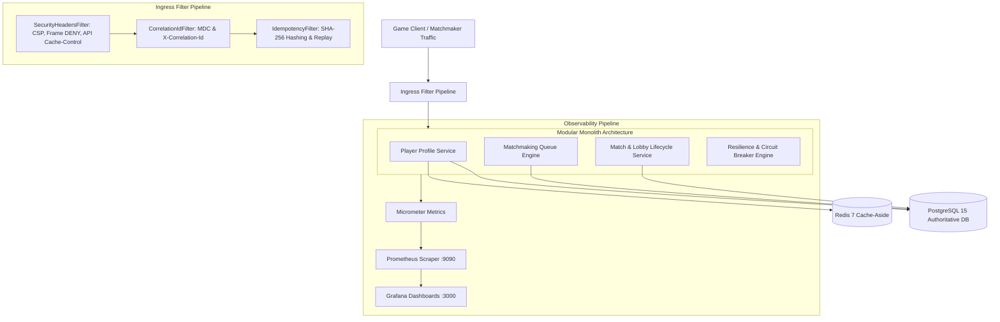
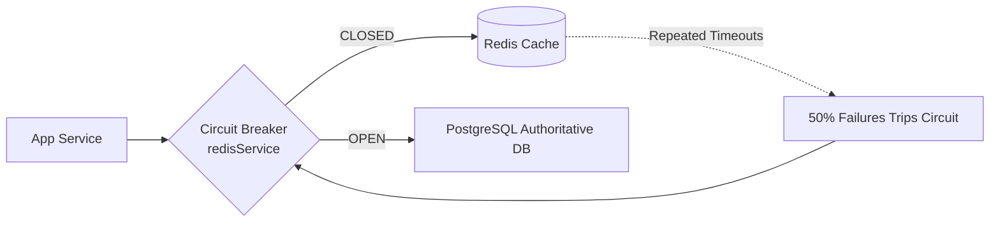

# GamePulse — Gameplay Services Platform

[](https://github.com/rohith-chitturi/GamePulse/actions/workflows/ci.yml)
[](https://www.oracle.com/java/)
[](https://spring.io/projects/spring-boot)
[](https://www.postgresql.org/)
[](https://redis.io/)
[](https://prometheus.io/)
[](https://grafana.com/)
[](LICENSE)

GamePulse is an independent backend gameplay services platform built with Java 17 and Spring Boot 3. It simulates the core backend services required for competitive online multiplayer games: player profile management, deterministic matchmaking, authoritative match lobbies, and telemetry, with strong data integrity guarantees under concurrent load and simulated network failure.

---

## 1. Overview & Architecture

Multiplayer game backends require strict consistency: player actions must not breach lobby capacities, network retries must not execute duplicate mutations, and third-party or downstream outages must not take down core gameplay.

GamePulse addresses these challenges with a modular Spring Boot architecture:
- **Player Profiles**: Authoritative profile records, MMR tracking, and cache-aside reads using Redis with automatic database fallback.
- **Deterministic Matchmaking**: FIFO queue with expanding MMR search windows and candidate detachment to avoid entity lock conflicts.
- **Lobby Lifecycle**: Authoritative state machines (`WAITING_FOR_PLAYERS` -> `IN_PROGRESS` -> `COMPLETED`) with pessimistic write locking to enforce hard player limits.
- **Application Idempotency**: Transparent request caching and response replay via `Idempotency-Key` headers and SHA-256 payload hashing.
- **Resilience**: Resilience4j circuit breakers and retries isolating Redis and downstream services, with configurable failure injection for testing.



---

## 2. Technology Stack & Component Inventory

| Layer | Technology | Version | Purpose |
| :--- | :--- | :--- | :--- |
| **Runtime** | Java LTS | 17.0.12 | Strongly typed enterprise runtime |
| **Framework** | Spring Boot | 3.3.5 | Core dependency injection, Web MVC, and lifecycle orchestration |
| **Database** | PostgreSQL | 15-Alpine | ACID transactional persistence with row-level locks |
| **Distributed Cache** | Redis | 7-Alpine | High-speed cache-aside layer with auto-degradation |
| **Resilience** | Resilience4j | 2.2.0 | Circuit breakers, bounded exponential retries, rate limits |
| **Telemetry** | Micrometer & Prometheus | 2.54.1 | Custom dimensional metrics and pull-model scraping |
| **Dashboards** | Grafana | 11.2.0 | Real-time connection pool, circuit breaker, and latency dashboards |
| **Load Testing** | Grafana k6 | 2.3.0 | Multi-scenario concurrency benchmarking engine |
| **Containerization** | Docker & Compose | v29 / v5 | Isolated 5-service container deployment topology |

---

## 3. Core Gameplay Subsystems

### 3.1 Player Profile Service (`com.gamepulse.player`)
- **Authoritative Identity**: Manages player registration, MMR matchmaking ratings, and player lifecycle states (`ONLINE`, `IN_QUEUE`, `IN_MATCH`, `OFFLINE`).
- **Resilient Cache-Aside**:
  - Hot reads query Redis (`player:{id}`).
  - If Redis times out (> 2000ms) or is unreachable, requests degrade to PostgreSQL automatically with zero user impact.
  - Profile updates perform atomic database writes and cache invalidations.

### 3.2 Deterministic Matchmaking Service (`com.gamepulse.matchmaking`)
- **Fair FIFO Queuing**: Ingress players are queued with baseline MMR search windows.
- **Dynamic Tolerance Expansion**: Ticket wait duration expands search tolerance dynamically (`baseTolerance = 100`, `expansionRate = 5 MMR/sec`, `maxTolerance = 1000`).
- **Candidate Detachment**: Queries decouple candidate tickets from Hibernate persistence contexts before evaluation to eliminate stale version collisions under concurrent sweeps.

### 3.3 Authoritative Lobby & Session Service (`com.gamepulse.session`)
- **Session State Machine**: Governs deterministic transitions:
  $$\text{WAITING\_FOR\_PLAYERS} \longrightarrow \text{IN\_PROGRESS} \longrightarrow \text{COMPLETED} \text{ / } \text{CANCELLED}$$
- **Capacity Boundaries**: Enforces strict player capacity limits (`maxPlayers`) using pessimistic row locking.

---

## 4. Concurrency Guarantees & Transaction Isolation

Multi-user gameplay backends cannot tolerate overfilled matches or duplicate matchmaker claims. GamePulse enforces consistency at the database layer:

| Invariant | Problem Prevented | Mechanism | Guarantee |
| :--- | :--- | :--- | :--- |
| **Lobby Capacity** | Burst of players joining a full lobby | `PESSIMISTIC_WRITE` row lock on `MatchSession` | Roster count strictly never exceeds `maxPlayers`. Verified under 200 concurrent VUs. |
| **Queue Uniqueness** | Rapid double-click or network duplicate enqueue | Status check under row lock | A player can have at most one active `QUEUED` ticket across the system. |
| **Ticket Claiming** | Concurrent sweeps selecting the same player | Atomic multi-row locking via `findByIdsWithLock` | A ticket cannot transition to `MATCHED` more than once; double assignment is impossible. |
| **Detached Persistence** | Stale Hibernate entity flush conflicts | Explicit `EntityManager.detach()` on candidates | Eliminates `ObjectOptimisticLockingFailureException` during concurrent matchmaking sweeps. |

---

## 5. Idempotency Controls

Mutating endpoints (`POST /api/v1/players`, `/matchmaking/queue`, `/matches/lobbies`, `/complete`) support idempotency via the `Idempotency-Key` HTTP header.

1. **SHA-256 Hashing**: Generates a digest from the incoming request body and URI path.
2. **Atomic Lease**: Inserts an `IdempotencyRecord` with status `PROCESSING`.
   - **Concurrent Duplicate**: Returns HTTP 409 `CONCURRENT_IDEMPOTENT_REQUEST`.
   - **Mismatched Payload Hash**: Returns HTTP 422 `CONFLICTING_IDEMPOTENCY_KEY`.
3. **Response Replay**: On completion, stores the HTTP status code and response payload. Subsequent retries replay the cached response with an `Idempotency-Replayed: true` header.

---

## 6. Resilience & Fault Tolerance



1. **Circuit Breakers (`Resilience4j`)**:
   - `redisService`: Sliding window (5 calls, 50% threshold). Trips to OPEN if Redis fails, preventing thread starvation.
   - `downstreamService`: Protects match completion notifications from third-party analytics latency.
2. **Bounded Exponential Retries**:
   - Deadlocks and transient socket errors are retried up to 3 times with exponential backoff (100ms multiplier). Non-idempotent operations are not retried.
3. **Controlled Fault Injection**:
   - Simulation endpoints allow failure testing in local/staging environments.
   - Protected in production by `gamepulse.chaos.enabled=false`, returning HTTP 403 `CHAOS_DISABLED`.

---

## 7. Performance Benchmarks

Performance testing was conducted using **Grafana k6** running against the live multi-container Docker Compose infrastructure:

| Profile | Virtual Users (VUs) | Duration | Total Requests | Throughput (RPS) | Average Latency | p95 Latency | Profile Read p95 | Unexpected Errors |
| :--- | :---: | :---: | :---: | :---: | :---: | :---: | :---: | :---: |
| **Baseline** | 25 | 2m | 25,002 | 207.78 req/s | 62.80 ms | 205.19 ms | 45.55 ms | **0.00%** |
| **Moderate** | 50 | 3m | 46,370 | 257.55 req/s | 124.68 ms | 389.50 ms | 123.00 ms | **0.00%** |
| **High** | 100 | 3m | 47,336 | 262.60 req/s | 281.61 ms | 871.72 ms | 465.00 ms | **0.00%** |

### Connection Pool Saturation at 100 VUs

Throughput grew from 207.78 req/s (25 VUs) to 257.55 req/s (50 VUs), then plateaued at 262.60 req/s (100 VUs).

This represents a clear database connection pool bottleneck:
- HikariCP is configured with a 25-connection ceiling (`HIKARI_MAX_POOL_SIZE: 25`).
- At 50 VUs, requests completed fast enough that connections were returned promptly.
- At 100 VUs, all 25 connections were continuously saturated. Incoming requests queued in memory waiting for connection checkout, increasing p95 latency from 389.50 ms to 871.72 ms.
- Because threads were queued rather than dropping, reliability remained at 100%: zero connection timeouts, zero unhandled 500 errors, and zero data corruption across 47,336 requests.
- For higher throughput (> 300 req/s), the next steps are increasing pool size and adding read replicas for player lookups.

---

## 8. Security Hardening

1. **Externalized Secrets**: All credentials and ports are configurable via environment variables. A template is provided in `.env.example`.
2. **Strict CORS**: Avoids wildcard `*` origins in production; origins are restricted via `CORS_ALLOWED_ORIGINS`.
3. **HTTP Security Headers**: Enforces baseline security headers across all responses:
   - `X-Content-Type-Options: nosniff`
   - `X-Frame-Options: DENY`
   - `X-XSS-Protection: 0`
   - `Referrer-Policy: strict-origin-when-cross-origin`
   - `Permissions-Policy: geolocation=(), camera=(), microphone=()`
   - `Content-Security-Policy: default-src 'self'; frame-ancestors 'none'`
4. **API Cache Prevention**: Sets `Cache-Control: no-cache, no-store, max-age=0, must-revalidate` on all `/api/*` routes.
5. **Actuator Lockdown**: Restricted to `health,info,prometheus,metrics`. Health details require authorization in production (`when-authorized`).
6. **Chaos Protection**: Fault injection controls return HTTP 403 `CHAOS_DISABLED` when `gamepulse.chaos.enabled=false`.

---

## 9. Docker Deployment

Launch the complete stack with Docker Compose:

```bash
# 1. Prepare environment variables
cp .env.example .env

# 2. Launch services
docker compose up -d

# 3. Check health status
docker compose ps
```

| Service | Container Name | Port Mapping | Health Check |
| :--- | :--- | :--- | :--- |
| **gamepulse-app** | `gamepulse-app` | `8080:8080` | `curl -f http://localhost:8080/actuator/health` |
| **postgres** | `gamepulse-postgres` | `5433:5432` | `pg_isready -U gamepulse -d gamepulsedb` |
| **redis** | `gamepulse-redis` | `6381:6379` | `redis-cli ping` |
| **prometheus** | `gamepulse-prometheus` | `9090:9090` | `wget -q --spider http://localhost:9090/-/healthy` |
| **grafana** | `gamepulse-grafana` | `3000:3000` | `wget -q --spider http://localhost:3000/api/health` |

---

## 10. API Documentation

Interactive Swagger UI and OpenAPI 3.0 specs are available at:
- **Swagger UI**: [http://localhost:8080/swagger-ui/index.html](http://localhost:8080/swagger-ui/index.html)
- **OpenAPI Schema**: [http://localhost:8080/v3/api-docs](http://localhost:8080/v3/api-docs)

### Primary Endpoints

| Method | Endpoint | Description | Idempotency Key |
| :--- | :--- | :--- | :---: |
| `POST` | `/api/v1/players` | Create player profile | Supported |
| `GET` | `/api/v1/players/{id}` | Read player profile (cache-aside) | N/A (GET) |
| `POST` | `/api/v1/matchmaking/queue` | Enqueue player for matchmaking | Supported |
| `GET` | `/api/v1/matchmaking/tickets/{id}` | Query ticket status | N/A (GET) |
| `POST` | `/api/v1/matches/lobbies` | Create match lobby | Supported |
| `POST` | `/api/v1/matches/{id}/join` | Join lobby slot (pessimistic lock) | No |
| `POST` | `/api/v1/matches/{id}/start` | Start match session | Supported |
| `POST` | `/api/v1/matches/{id}/complete` | Complete match and record winner | Supported |
| `GET` | `/api/v1/resilience/status` | Real-time circuit breaker status | N/A (GET) |

---

## 11. Monitoring & Grafana Dashboards

Pre-configured dashboards are available in Grafana ([http://localhost:3000](http://localhost:3000)):
- **HikariCP Pool**: Active, idle, pending, and maximum connections.
- **Resilience4j Circuit Breakers**: Real-time state of `downstreamService` and `redisService`.
- **Request Latency & Throughput**: p50, p90, p95, p99 request duration breakdown by route.
- **JVM & GC**: Heap utilization and GC pause duration.

---

## 12. Automated Tests & CI

The automated test suite runs on pull requests via GitHub Actions:

```bash
# Full test suite (56 tests)
.\mvnw.cmd clean test

# Concurrency & idempotency tests
.\mvnw.cmd test "-Dtest=ConcurrencyIntegrationTest,IdempotencyIntegrationTest"

# Resilience & security tests
.\mvnw.cmd test "-Dtest=SecurityAndChaosProtectionIntegrationTest,ResilienceIntegrationTest"
```

---

## 13. End-to-End Verification Script

A PowerShell script is included to smoke-test all core flows against the running Docker containers:

```powershell
.\scripts\demo.ps1
```

The script verifies:
1. Container health and Actuator endpoints.
2. Player creation and Redis cache lookup.
3. Matchmaking enqueue and ticket lookup.
4. Idempotent lobby creation and replay assertion (`Idempotency-Replayed: true`).
5. Lobby slot reservation and rejection of a 3rd player (`409 CAPACITY_EXCEEDED`).
6. Match start and completion lifecycle.
7. Chaos endpoint protection (`403 CHAOS_DISABLED`).

---

## 14. Documentation Index

- [Architecture Specification](docs/architecture/ARCHITECTURE.md)
- [Operations Runbook](docs/OPERATIONS_RUNBOOK.md)
- [Security Review](docs/SECURITY_REVIEW.md)
- [Performance Benchmark Report](docs/PERFORMANCE_BENCHMARK_REPORT.md)
- [Resilience & Failure Test Report](docs/RESILIENCE_TEST_REPORT.md)
- [Concurrency & Idempotency Specification](docs/architecture/CONCURRENCY_AND_IDEMPOTENCY.md)

---

## License

This project is licensed under the MIT License — see the [LICENSE](LICENSE) file for details.
