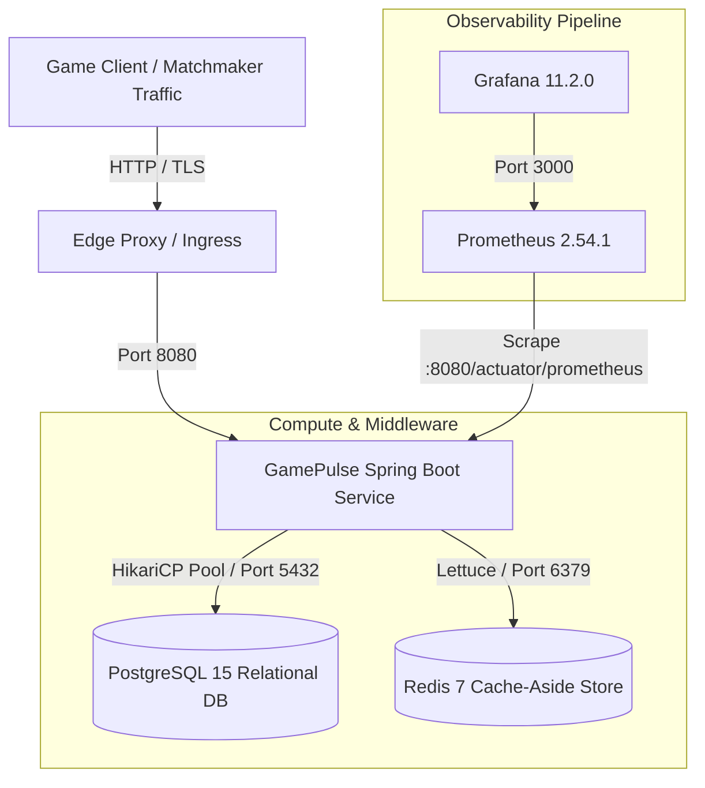

# GamePulse Operations Runbook

> **Target Audience**: Site Reliability Engineers (SRE), Platform Engineers, DevOps, and On-Call Engineers  
> **Platform Version**: 0.1.0-SNAPSHOT  
> **Classification**: Production Operations Manual & Incident Response  

---

## 1. System Overview & Architecture Topology

GamePulse is an enterprise-grade backend platform simulating online multiplayer matchmaking, player profile management, and game lobby lifecycle operations.



### Component Inventory

| Component | Technology | Default Port | Internal Service Name | Purpose |
| :--- | :--- | :--- | :--- | :--- |
| **gamepulse-app** | Spring Boot 3.3.5 / JDK 17 | 8080 | `gamepulse-app` | Core REST APIs, session management, matchmaking engine |
| **postgres** | PostgreSQL 15-Alpine | 5433 (host) / 5432 | `postgres` | Authoritative persistence: players, lobbies, tickets, idempotency records |
| **redis** | Redis 7-Alpine | 6381 (host) / 6379 | `redis` | Cache-aside profile layer with Resilience4j circuit breaking |
| **prometheus** | Prometheus 2.54.1 | 9090 | `prometheus` | Time-series metrics collection via pull model (5s scrape interval) |
| **grafana** | Grafana 11.2.0 | 3000 | `grafana` | Real-time dashboards, pool saturation, and circuit breaker telemetry |

---

## 2. Bootstrapping & Lifecycle Management

### 2.1 Starting the Production Stack (Docker Compose)

```bash
# 1. Prepare environment variables from template
cp .env.example .env
# Edit .env and supply secure passwords

# 2. Start all services in detached mode
docker compose up -d

# 3. Verify health status of all containers
docker compose ps
```

Expected health status: All containers (`gamepulse-app`, `gamepulse-postgres`, `gamepulse-redis`, `gamepulse-prometheus`, `gamepulse-grafana`) must display `healthy` or `running`.

### 2.2 Starting Standalone Spring Boot Application

For localized development or out-of-container staging:

```powershell
# Set active profile and production flags
$env:SPRING_PROFILES_ACTIVE = "prod"
$env:GAMEPULSE_CHAOS_ENABLED = "false"
$env:SPRING_DATASOURCE_URL = "jdbc:postgresql://localhost:5433/gamepulsedb"
$env:SPRING_DATASOURCE_USERNAME = "gamepulse"
$env:SPRING_DATASOURCE_PASSWORD = "your_secure_postgres_password_here"

# Launch Spring Boot
.\mvnw.cmd spring-boot:run
```

### 2.3 Graceful Shutdown & Request Draining

GamePulse is configured with graceful shutdown to prevent request termination and database connection dropping in-flight:

```yaml
server:
  shutdown: graceful
spring:
  lifecycle:
    timeout-per-shutdown-phase: 20s
```

When receiving `SIGTERM` or `SIGINT`:
1. Tomcat stops accepting new TCP connections on port 8080.
2. In-flight requests are permitted up to 20 seconds to complete cleanly.
3. Database transactions finish and commit/rollback naturally.
4. HikariCP closes idle and returning connections.
5. Container shuts down cleanly with exit code 0.

To safely stop the cluster:
```bash
docker compose stop -t 25
```

---

## 3. Health Probes & Readiness Lifecycle

GamePulse exposes Spring Boot Actuator endpoints configured with Kubernetes-style liveness and readiness probes:

| Endpoint | Purpose | Healthy Status Code | Evaluation Invariant |
| :--- | :--- | :--- | :--- |
| `GET /actuator/health` | Composite System Health | `200 OK` | Overall system operational |
| `GET /actuator/health/liveness` | Container Liveness Probe | `200 OK` (`{"status":"UP"}`) | JVM and web server are responsive |
| `GET /actuator/health/readiness` | Ingress Readiness Probe | `200 OK` (`{"status":"UP"}`) | Database connection pool accepting queries |
| `GET /api/v1/system/info` | Application Metadata | `200 OK` | Version, environment, active profile |
| `GET /api/v1/resilience/status` | Resilience & Circuit Telemetry | `200 OK` | Circuit breaker states, cache availability |

### Production Health Policy (`application-prod.yml`)
In production environments, detailed stack traces and component breakdowns on `/actuator/health` are restricted using `management.endpoint.health.show-details: when-authorized` to prevent reconnaissance by unauthenticated callers.

---

## 4. Structured Logging & Distributed Tracing

### 4.1 Correlation ID Tracing
Every request entering GamePulse is intercepted by `CorrelationIdFilter`:
- If the incoming client supplies `X-Correlation-Id`, that token is reused.
- If missing, a secure random UUIDv4 is generated.
- The token is placed into SLF4J MDC under key `correlationId` and echoed in the HTTP response header `X-Correlation-Id`.

### 4.2 Standard Log Format
```
2026-11-06 15:18:48.381 [http-nio-8080-exec-1] [f47ac10b-58cc-4372-a567-0e02b2c3d479] INFO  c.g.p.s.PlayerService - Created player profile: id=...
```

### 4.3 Log Triage & Filtering
```bash
# Filter all logs for a specific user transaction by correlation ID
docker compose logs gamepulse-app | grep "f47ac10b-58cc-4372-a567-0e02b2c3d479"

# Watch for database connection warnings
docker compose logs -f gamepulse-app | grep "GamePulseHikariPool"

# Inspect Resilience4j circuit state changes
docker compose logs -f gamepulse-app | grep "CircuitBreaker"
```

---

## 5. Database Connection Pool (HikariCP) Management

GamePulse relies on HikariCP as its high-throughput connection pool connecting to PostgreSQL.

### Configuration Parameters
- **`maximum-pool-size`**: `25` (tuned for high concurrency without PostgreSQL lock thrashing)
- **`minimum-idle`**: `10`
- **`connection-timeout`**: `3000ms` (fail-fast timeout before throwing `SQLTransientConnectionException`)
- **`validation-timeout`**: `2000ms`
- **`idle-timeout`**: `600000ms` (10 minutes)
- **`max-lifetime`**: `1800000ms` (30 minutes)
- **`leak-detection-threshold`**: `5000ms` (logs stack trace if a thread holds a connection > 5 seconds)

### Saturation Telemetry & Metrics
Prometheus metrics exposed by HikariCP:
- `hikaricp_connections_active{pool="GamePulseHikariPool"}`: Number of in-use connections executing queries.
- `hikaricp_connections_idle{pool="GamePulseHikariPool"}`: Warm connections ready for immediate checkout.
- `hikaricp_connections_pending{pool="GamePulseHikariPool"}`: Requests waiting in queue for a connection.
- `hikaricp_connections_timeout_total{pool="GamePulseHikariPool"}`: Cumulative requests timed out waiting for connection.

> **Operational Warning**: If `pending > 5` for sustained intervals (> 15 seconds) or `timeout_total` increments, the system has exceeded connection pool capacity. See Playbook 4.

---

## 6. Redis Degradation & Cache Architecture

GamePulse implements **resilient cache-aside** for Player profiles (`RedisResilienceService`):
1. **Cache Read**: `GET player:{id}`. If Redis is unavailable or times out (> 2000ms), the query falls back to PostgreSQL seamlessly.
2. **Circuit Protection**: Repeated Redis connection failures trip `redisService` circuit breaker (sliding window: 5 calls, 50% failure threshold).
3. **Graceful Fallback**: While the circuit is OPEN, Redis calls are skipped entirely, relieving pressure on the cache and protecting request latency from repeated timeouts.
4. **Auto-Recovery**: After `waitDurationInOpenState: 5000ms`, the circuit transitions to HALF-OPEN, testing 2 probe requests. If Redis has recovered, the circuit switches back to CLOSED.

---

## 7. Prometheus & Grafana Monitoring

### Grafana Dashboard
Access Grafana at `http://localhost:3000` (default credentials in `.env`). The pre-provisioned **GamePulse - System Overview** dashboard includes:
1. **HTTP Throughput & Error Rate**: Requests/sec, 2xx/4xx/5xx breakdown.
2. **Latency Percentiles**: p50, p90, p95, p99 request duration.
3. **HikariCP Connection Pool**: Active vs. Idle vs. Pending vs. Max.
4. **Resilience4j Circuit Breaker States**: Real-time state of `downstreamService` and `redisService` (0 = Closed, 1 = Open, 2 = Half-Open).
5. **JVM Memory & Garbage Collection**: Heap utilization, GC pauses.

### Recommended Alerting Rules

| Alert Name | Metric Expression | Condition | Severity | Description |
| :--- | :--- | :--- | :--- | :--- |
| `HikariCPPoolExhausted` | `hikaricp_connections_pending > 5` | For > 30s | Critical | In-flight requests queuing for DB connections |
| `HighHttp5xxRate` | `rate(http_server_requests_seconds_count{status=~"5.."}[1m]) > 0.05` | For > 1m | Critical | Server error rate exceeds 5% of traffic |
| `CircuitBreakerTripped` | `resilience4j_circuitbreaker_state{state="open"} == 1` | For > 10s | Warning | Downstream or cache dependency circuit opened |
| `HighP95Latency` | `histogram_quantile(0.95, sum(rate(http_server_requests_seconds_bucket[2m])) by (le)) > 1.0` | For > 2m | Warning | API p95 latency exceeds 1,000ms |

---

## 8. Incident Recovery Playbooks

### Playbook 1: PostgreSQL Unreachable (`DATABASE_UNAVAILABLE` 503)

**Symptoms**:
- API requests return HTTP 503 with body `{"errorCode": "DATABASE_UNAVAILABLE"}`.
- Logs display `CannotCreateTransactionException` or `SQLTransientConnectionException`.
- Grafana shows `hikaricp_connections_timeout_total` climbing.

**Triage Steps**:
1. Check PostgreSQL container health:
   ```bash
   docker compose ps postgres
   ```
2. Inspect PostgreSQL database logs:
   ```bash
   docker compose logs --tail=50 postgres
   ```
3. Test connectivity directly using `pg_isready`:
   ```bash
   docker exec -it gamepulse-postgres pg_isready -U gamepulse -d gamepulsedb
   ```
4. If PostgreSQL crashed or stopped, restart container:
   ```bash
   docker compose restart postgres
   ```
5. Confirm application re-establishes pool connections automatically within 10 seconds.

---

### Playbook 2: Redis Cache Unavailable

**Symptoms**:
- Logs show `RedisConnectionFailureException` or `Querying PostgreSQL authoritative store directly`.
- `GET /api/v1/resilience/status` reports `"redis": {"available": false}`.
- Latency for profile reads slightly increases due to direct DB queries, but HTTP responses remain `200 OK`.

**Action**:
1. Verify Redis container status:
   ```bash
   docker compose ps redis
   ```
2. Ping Redis directly:
   ```bash
   docker exec -it gamepulse-redis redis-cli ping
   ```
3. If Redis is down, restart it:
   ```bash
   docker compose restart redis
   ```
4. Once Redis responds to PING, `RedisResilienceService` resumes cache reads without application restart.

---

### Playbook 3: Circuit Breaker Open (`CIRCUIT_BREAKER_OPEN` 503)

**Symptoms**:
- API endpoints depending on downstream integrations return HTTP 503 `CIRCUIT_BREAKER_OPEN`.
- Logs indicate `CallNotPermittedException`.

**Action**:
1. Inspect resilience status:
   ```bash
   curl -s http://localhost:8080/api/v1/resilience/status
   ```
2. Check whether downstream service is healthy or if chaos simulation was inadvertently left active:
   ```bash
   # In non-production environments with chaos enabled:
   curl -X POST http://localhost:8080/api/v1/resilience/chaos/downstream -H "Content-Type: application/json" -d '{"active": false}'
   curl -X POST http://localhost:8080/api/v1/resilience/circuit-breakers/downstreamService/transition/reset
   ```
3. In production, investigate downstream network route and await automatic half-open evaluation (5-second recovery window).

---

### Playbook 4: Database Connection Pool Saturation (High VU Latency)

**Symptoms**:
- Heavy traffic (> 50–100 concurrent VUs).
- `hikaricp_connections_active` stays at 25/25.
- `hikaricp_connections_pending` rises to > 10.
- p95 latency increases up to 870ms, though error rate remains 0.00%.

**Action**:
1. Inspect PostgreSQL active queries:
   ```sql
   SELECT pid, now() - query_start AS duration, query, state FROM pg_stat_activity WHERE state != 'idle';
   ```
2. If host hardware permits (CPU/RAM headroom available), scale connection pool in `.env`:
   ```bash
   HIKARI_MAX_POOL_SIZE=40
   HIKARI_MIN_IDLE=15
   ```
3. Restart application with updated configuration:
   ```bash
   docker compose up -d gamepulse-app
   ```
