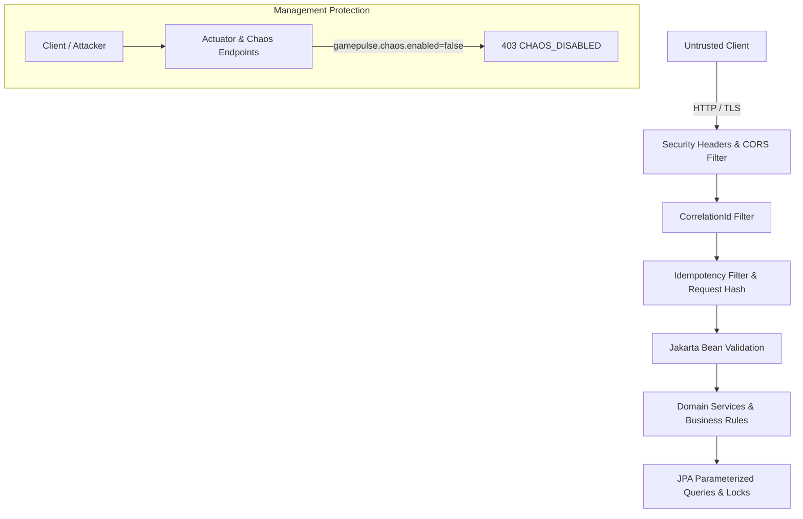

# GamePulse Security Review & Threat Analysis

> **Target Audience**: Security Engineers, Platform Architects, and Technical Evaluators  
> **Platform Version**: 0.1.0-SNAPSHOT  
> **Classification**: Security Architecture & Hardening Assessment  

---

## 1. Executive Summary & Security Posture

GamePulse implements defense-in-depth across its multiplayer gameplay backend services. Because online multiplayer platforms are frequent targets for credential theft, denial-of-service (DoS), race-condition exploits (e.g., ticket duplication, double matchmaking claims), and data tampering, the platform enforces strict data validation, concurrency locking, security headers, Actuator lockdown, and chaos surface gating.

---

## 2. Threat Modeling & Attack Surface

| Asset / Surface | Threat Vector | Risk Level | Mitigation Implemented |
| :--- | :--- | :--- | :--- |
| **Player MMR & Profiles** | Unauthorized modification, parameter tampering | High | Immutable entity IDs; strict DTO validation (`@Size`, `@Email`); parameterized queries |
| **Matchmaking Queue** | Duplicate ticket enqueue, queue flooding | High | Pessimistic DB locking, deterministic ticket lifecycle state machine, uniqueness constraints |
| **Lobby Capacity** | Race condition to overfill lobby (> max capacity) | High | Pessimistic write lock (`PESSIMISTIC_WRITE`) on `MatchSession`; atomic slot verification |
| **Mutating APIs** | Network retries triggering double actions | High | SHA-256 idempotency cache filter with cached responses & conflict detection |
| **Chaos Endpoints** | Malicious callers disabling services via chaos toggles | Critical | Chaos routes gated behind `gamepulse.chaos.enabled=false` returning HTTP 403 `CHAOS_DISABLED` |
| **Observability (Actuator)** | Reconnaissance via internal stack traces & config | Medium | Health details set to `when-authorized` in production; endpoints restricted to metrics/health |
| **Browser / Client Edge** | Clickjacking, MIME-sniffing, sensitive caching | Medium | `X-Frame-Options: DENY`, `X-Content-Type-Options: nosniff`, `Cache-Control: no-store` on API routes |

---

## 3. Secrets Management & Configuration Safety

1. **Zero Hardcoded Secrets**: All database passwords, Redis credentials, and Grafana tokens are externalized using Spring Boot environment variable placeholders (`${POSTGRES_PASSWORD:...}`).
2. **Template-Based Environment**: `.env.example` provides explicit placeholder values (`your_secure_postgres_password_here`) rather than live credentials.
3. **Strict Git Ignoring**: The repository `.gitignore` explicitly ignores `.env`, `.env.local`, `*.key`, and `*.pem` files.
4. **Log Masking**: Passwords and connection secrets are never printed to stdout or SLF4J logs. Sensitive database URLs are referenced strictly via environment variables.

---

## 4. API Security & Validation Controls

### 4.1 Input Validation
All request payloads are strictly validated before hitting business logic using Jakarta Bean Validation (`@Valid`):
- `CreatePlayerRequest`:
  - `username`: `@NotBlank`, `@Size(min = 3, max = 30)`, strictly alphanumeric/safe characters.
  - `email`: `@NotBlank`, `@Email`, `@Size(max = 100)`.
  - `initialMmr`: `@Min(0)`, `@Max(5000)`.
- `CreateLobbyRequest`:
  - `name`: `@NotBlank`, `@Size(min = 3, max = 50)`.
  - `gameMode`: `@NotBlank`, `@Size(max = 30)`.
  - `maxPlayers`: `@Min(2)`, `@Max(16)`.

Validation failures are intercepted by `GlobalExceptionHandler` and returned as RFC 7807 responses (`VALIDATION_FAILED`, HTTP 400) without exposing internal class names.

### 4.2 SQL & Query Injection Defense
All database interactions are managed through Spring Data JPA and Hibernate ORM:
- Zero raw string concatenation in SQL queries.
- All JPQL and native queries utilize typed named parameters (`:playerId`, `:status`).
- Entity IDs are strongly typed UUIDs.

---

## 5. Network & HTTP Hardening

### 5.1 Strict CORS Configuration (`WebCorsConfig.java`)
- **No Wildcard Origins**: In production environments, wildcard origins (`*`) are prohibited.
- **Configurable Origins**: Origins are restricted to explicit trusted hosts via `gamepulse.cors.allowed-origins` (`${CORS_ALLOWED_ORIGINS}`).
- **Allowed Methods**: Explicitly bounded to `GET, POST, PUT, DELETE, PATCH, OPTIONS, HEAD`.
- **Exposed Headers**: Only safe tracing headers (`X-Correlation-Id`, `Idempotency-Key`, `Idempotency-Replayed`) are exposed to client JavaScript.

### 5.2 Security Headers (`SecurityHeadersFilter.java`)
Every HTTP response emitted by GamePulse includes industry-standard security headers:
- `X-Content-Type-Options: nosniff` — Prevents browsers from MIME-sniffing away from the declared content-type.
- `X-Frame-Options: DENY` — Completely prevents framing and clickjacking attacks.
- `X-XSS-Protection: 0` — Disables legacy, insecure browser XSS filters in favor of modern CSP.
- `Referrer-Policy: strict-origin-when-cross-origin` — Protects path and query privacy across origins.
- `Permissions-Policy: geolocation=(), camera=(), microphone=()` — Disables unnecessary browser APIs.
- `Content-Security-Policy: default-src 'self'; frame-ancestors 'none'` — Restricts resource loading to trusted origins and blocks framing.

### 5.3 Dynamic API Cache Prevention
Dynamic gameplay state, match results, and session tokens must never be cached by shared intermediary caches (CDNs, forward proxies) or browser local caches:
- For all `/api/*` endpoints, `SecurityHeadersFilter` injects:
  - `Cache-Control: no-cache, no-store, max-age=0, must-revalidate`
  - `Pragma: no-cache`
  - `Expires: 0`

---

## 6. Actuator Lockdown & Chaos Surface Gating

### 6.1 Actuator Surface Exposure
In production (`application-prod.yml`):
- Exposed endpoints: strictly `health`, `info`, `prometheus`, `metrics`.
- Sensitive operational actuators (`env`, `beans`, `threaddump`, `heapdump`, `shutdown`) are **disabled and unexposed**.
- Health endpoint details: `management.endpoint.health.show-details: when-authorized`.

### 6.2 Chaos & Resilience Protection
GamePulse includes fault-injection controllers (`/api/v1/resilience/chaos/downstream` and `/circuit-breakers/{name}/transition/{action}`) designed for empirical failure verification in QA/testing environments.
- In production, these mutating endpoints are protected by `gamepulse.chaos.enabled: false`.
- Any attempt to trigger chaos or trip circuit breakers without authorization results in an immediate RFC 7807 response:
  - **HTTP 403 Forbidden**
  - **Error Code**: `CHAOS_DISABLED`
  - **Message**: *"Chaos fault injection is disabled in this environment."*

---

## 7. Concurrency & Race Condition Defense

1. **Lobby Capacity Invariant**: When players join a lobby concurrently, `MatchSessionService.joinLobby` acquires a `PESSIMISTIC_WRITE` lock on the `MatchSession` entity. This serializes slot checks at the database transaction level, guaranteeing that no lobby exceeds its configured `maxPlayers` even under 200 VU concurrency.
2. **Idempotency Deduplication**: Mutating requests with an `Idempotency-Key` are hashed (SHA-256) and tracked in `idempotency_records`. Concurrent requests with the same key receive HTTP 409 `CONCURRENT_IDEMPOTENT_REQUEST`, while subsequent retries receive the exact cached response with `Idempotency-Replayed: true`.
3. **Ticket State Isolation**: In `MatchmakingService`, candidate tickets are detached from Hibernate persistence contexts before processing to eliminate stale entity version collisions (`OptimisticLockException`).

---

## 8. Limitations & Future Hardening Roadmap

While GamePulse provides an enterprise-ready gameplay services foundation, production deployments operating on the public Internet should incorporate:
1. **Edge API Gateway & OAuth2/JWT**: Centralized authentication, JSON Web Token (JWT) validation, and player role claims (`ROLE_PLAYER`, `ROLE_ADMIN`) at an API Gateway tier (e.g., Spring Cloud Gateway or Kong).
2. **Distributed Rate Limiting**: Per-IP or per-player token bucket rate limiting using Redis Sorted Sets to defend against DDoS and brute-force ticket generation.
3. **mTLS for Internal Services**: Mutual TLS for communication between the API gateway, application containers, PostgreSQL, and Redis.
