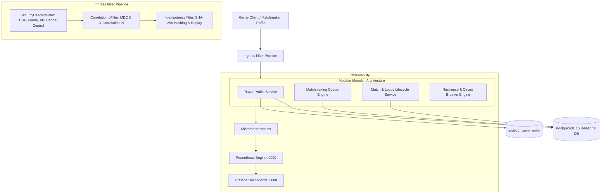
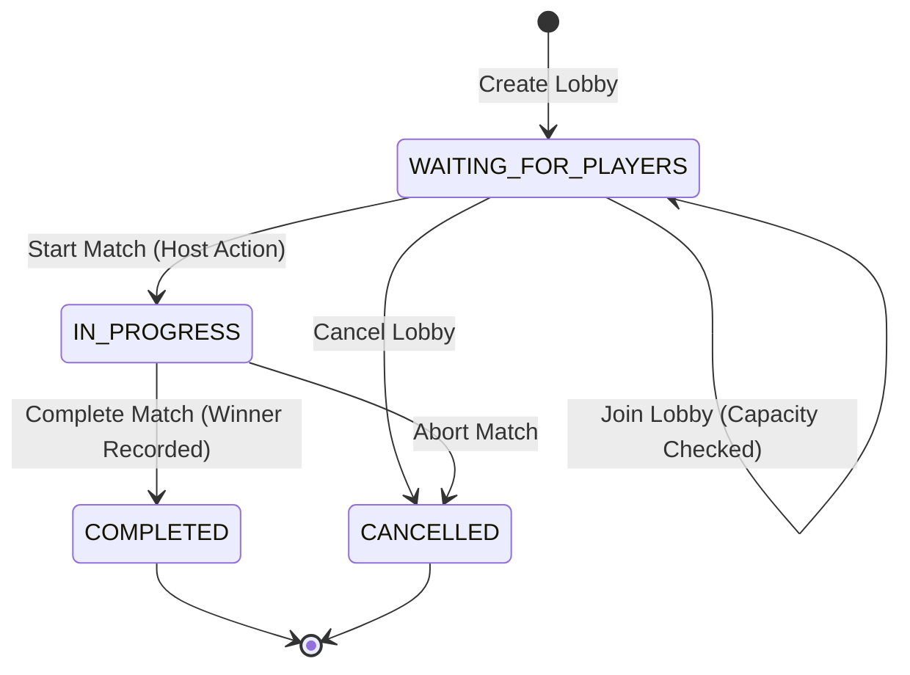
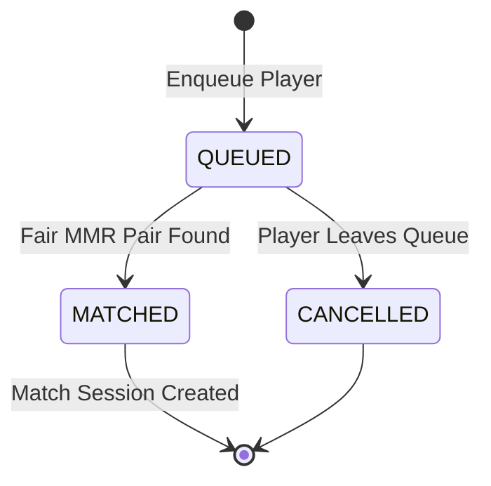

# GamePulse Technical Architecture Specification

> **Platform Version**: 0.1.0-SNAPSHOT  
> **Architecture Pattern**: Domain-Driven Modular Monolith with Containerized Distributed Infrastructure  
> **Target Audience**: Software Engineers, Distributed Systems Architects, and Technical Evaluators  

---

## 1. System Overview & Context

GamePulse is an enterprise-grade backend platform simulating the core distributed services required to run competitive real-time online multiplayer games (e.g., matchmaking queues, fair MMR pairing, authoritative match lobbies, and lifecycle events).

---

## 2. Domain Subsystems & Boundaries

GamePulse is partitioned into clear, encapsulated domain packages rooted under `com.gamepulse.*`:

### 2.1 Player Profile Service (`com.gamepulse.player`)
- **Responsibilities**: Player account registration, MMR ranking assignment, player status tracking (`ONLINE`, `IN_QUEUE`, `IN_MATCH`, `OFFLINE`).
- **Resilient Cache-Aside Pattern**:
  - Primary reads query Redis cache (`player:{id}`).
  - If Redis is unavailable or times out (> 2000ms), queries degrade gracefully to PostgreSQL without application failure.
  - Profile updates perform atomic database writes and cache invalidations.

### 2.2 Matchmaking Service (`com.gamepulse.matchmaking`)
- **Responsibilities**: Deterministic ticket admission, FIFO and MMR-based ticket pairing, dynamic search tolerance expansion, and match generation.
- **Concurrency & Transaction Boundaries**:
  - Uses explicit `EntityManager` detachment to decouple queried candidate tickets from Hibernate persistence contexts before processing, preventing stale entity version collisions (`OptimisticLockException`).
  - Strict deduplication: A player cannot have more than one active `QUEUED` ticket simultaneously.

### 2.3 Lobby & Session Service (`com.gamepulse.session`)
- **Responsibilities**: Authoritative lobby creation, roster slot reservation, match lifecycle state transitions (`WAITING_FOR_PLAYERS`, `IN_PROGRESS`, `COMPLETED`, `CANCELLED`), and winner resolution.
- **Pessimistic Concurrency Locking**:
  - `joinLobby()` uses `LockModeType.PESSIMISTIC_WRITE` on `MatchSession` to guarantee atomic capacity enforcement up to the configured `maxPlayers`. Even under 200 concurrent requests, capacity is never breached.

### 2.4 Idempotency Engine (`com.gamepulse.core.idempotency`)
- **Responsibilities**: Deduplication of mutating REST API operations (`POST`, `PUT`, `PATCH`, `DELETE`) carrying the `Idempotency-Key` header.
- **Execution Flow**:
  1. Hashing: Computes SHA-256 hash of the incoming request body and HTTP path.
  2. Record Insertion: Inserts `IdempotencyRecord` with status `PROCESSING`.
  3. Collision Handling: If another thread is executing the same key, throws HTTP 409 `CONCURRENT_IDEMPOTENT_REQUEST`. If keys match but payload hashes differ, throws HTTP 422 `CONFLICTING_IDEMPOTENCY_KEY`.
  4. Caching & Replay: On completion, captures status code and JSON payload. Subsequent identical retries replay the cached response immediately with `Idempotency-Replayed: true`.

### 2.5 Resilience Engine (`com.gamepulse.core.resilience`)
- **Responsibilities**: Fault isolation, circuit breaker management, bounded retries, and chaos fault injection testing.
- **Circuit Breakers**:
  - `redisService`: Circuit trips after 5 calls with 50% failure rate; 5-second wait duration in OPEN before half-open probe.
  - `downstreamService`: Protects match completion notifications from external latency/timeouts.
- **Production Guarding**: All chaos injection endpoints are guarded by `gamepulse.chaos.enabled=false` returning HTTP 403 `CHAOS_DISABLED` when disabled.

---

## 3. Data Flow & State Machines

### 3.1 Match Session State Transitions

### 3.2 Matchmaking Ticket State Transitions

---

## 4. Multi-Container Infrastructure Topology

The production and evaluation deployment is orchestrated using Docker Compose (`docker-compose.yml`):

| Container Name | Base Image | Role | Port Bindings | Health Probe |
| :--- | :--- | :--- | :--- | :--- |
| `gamepulse-app` | `eclipse-temurin:17-jre-alpine` (multi-stage build) | Core Service | `8080:8080` | `curl -f /actuator/health` |
| `gamepulse-postgres` | `postgres:15-alpine` | Authoritative DB | `5433:5432` | `pg_isready -U gamepulse` |
| `gamepulse-redis` | `redis:7-alpine` | Cache-Aside Store | `6381:6379` | `redis-cli ping` |
| `gamepulse-prometheus` | `prom/prometheus:v2.54.1` | Time-Series Metrics | `9090:9090` | `wget /-/healthy` |
| `gamepulse-grafana` | `grafana/grafana:11.2.0` | Dashboards | `3000:3000` | `wget /api/health` |

All services communicate over an isolated internal bridge network (`gamepulse-net`), ensuring external clients cannot access internal database or cache ports unless explicitly mapped.

---

## 5. Security & Operational Characteristics

1. **Structured MDC Logging**: Every log entry includes timestamp, thread, correlation ID, log level, and logger class.
2. **Graceful Draining**: The service allows up to 20 seconds for in-flight requests to complete before terminating JVM processes.
3. **Connection Pool Management**: HikariCP is configured with a 25-connection ceiling, leak detection at 5,000ms, and fast validation to prevent connection starvation.
4. **Security Headers**: Standard defense-in-depth headers (`X-Frame-Options: DENY`, `X-Content-Type-Options: nosniff`, `CSP`, and dynamic API cache prohibition) protect client interactions.
