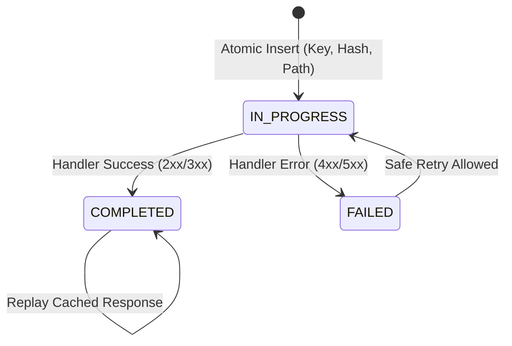

# Concurrency Control & Idempotency Specification

## 1. Overview
Multiplayer gameplay backends handle bursty, concurrent operations under erratic client network conditions. Network retries, rapid button clicks, and simultaneous lobby joins can corrupt match rosters, overfill lobbies, or double-assign players if transaction boundaries and concurrency controls are not strictly enforced.

GamePulse guarantees data integrity through two complementary mechanisms:
1. **Application-Level Idempotency (`Idempotency-Key` HTTP Header)**.
2. **Database-Level Concurrency Controls (Pessimistic Row Locks & Optimistic Versioning)**.

---

## 2. Idempotency Architecture

### Key Scope & Lifecycle
- **Header**: Clients provide `Idempotency-Key: <unique-token>` on mutating endpoints (`POST`, `PUT`, `PATCH`, `DELETE`).
- **Scope**: Keys are uniquely indexed and scoped to `(idempotencyKey, requestPath, SHA-256(requestPayload))`.
- **Expiration Policy**: Records carry an `expiresAt` timestamp (default 24-hour TTL) with scheduled cleanup.

### Execution & Collision Semantics
1. **First Execution**:
   - The filter computes the SHA-256 hash of the request body and executes an isolated atomic reservation (`Propagation.REQUIRES_NEW`) inserting an `IdempotencyRecord` in state `IN_PROGRESS`.
   - On completion (< 400), the response status, headers, and serialized body are committed.
2. **Legitimate Retry (Identical Key & Payload)**:
   - If the previous execution `COMPLETED`, the filter intercepts the request, bypasses downstream business services, and replays the cached response with header `Idempotency-Replayed: true`.
   - If the previous execution is still `IN_PROGRESS`, the filter rejects with `409 Conflict` (`CONCURRENT_REQUEST_IN_FLIGHT`) to prevent concurrent race conditions.
   - If the in-progress request exceeded the crash timeout (120s), the lease is reclaimed for crash recovery.
3. **Conflicting Key Reuse (Same Key, Different Payload or Endpoint)**:
   - If a client attempts to reuse a key for a different payload or endpoint, the filter rejects the request with `409 Conflict` (`IDEMPOTENCY_KEY_PAYLOAD_MISMATCH`), preventing cross-payload corruption.

---

## 3. Database Concurrency Control Matrix

| Operation | Concurrency Hazard | Isolation / Locking Mechanism | Rationale & Invariant Guaranteed |
| :--- | :--- | :--- | :--- |
| **Lobby Join** (`joinLobby`) | Parallel joins exceeding max capacity | `PESSIMISTIC_WRITE` row lock on `MatchSession` + `@Version` | Locks lobby row (`SELECT ... FOR UPDATE`), serializing roster checks so `players.size() < maxPlayers` is strictly evaluated. Lobby capacity is never breached. |
| **Lobby Membership** | Duplicate player insertion in same lobby | Composite Unique Constraint `(match_session_id, player_id)` | Guarantees database-level rejection if duplicate join requests bypass application checks. |
| **Queue Entry** (`enqueuePlayer`) | Simultaneous queue requests creating duplicate active tickets | `PESSIMISTIC_WRITE` row lock on `Player` + status check | Locks player row. If player state is already `IN_QUEUE` or `IN_MATCH`, conflicting concurrent enqueue calls are rejected immediately. |
| **Match Evaluation** (`evaluateMatches`) | Two matchmaker workers assigning the same player to two matches | `PESSIMISTIC_WRITE` multi-ticket row lock | Atomically locks candidate pair `(ticketA, ticketB)`. Re-validates `status == QUEUED` for both tickets before forming session. Prevents double-matching. |
| **Lifecycle Transitions** (`startMatch`, `completeMatch`, `cancelMatch`) | Race between match completion and host cancellation | `PESSIMISTIC_WRITE` row lock on `MatchSession` | Serializes state transitions; checks `status.canTransitionTo(...)` while holding lock. |

---

## 4. Concurrency Verification Evidence
- **Parallel Lobby Joins**: 10 simultaneous threads released at the same millisecond attempting to fill 1 remaining slot in a 2-player lobby:
  - Exactly 1 thread received `200 OK`.
  - 9 threads received `409 Conflict` (`CAPACITY_EXCEEDED`).
  - Database verification confirmed `match_players` count remained strictly 2.
- **Concurrent Duplicate Enqueue**: 5 parallel burst requests for the same player:
  - Exactly 1 thread received `201 Created`.
  - 4 threads received `409 Conflict` (`DUPLICATE_RESOURCE`).
  - Database verification confirmed exactly 1 active `QUEUED` ticket existed.

