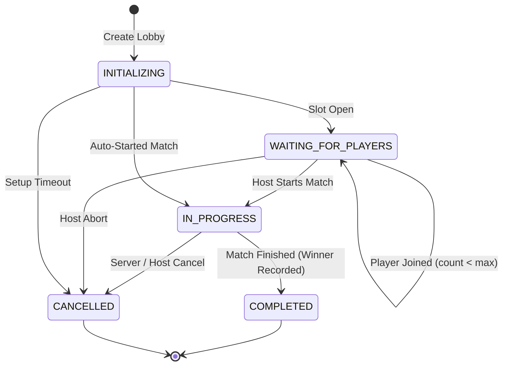
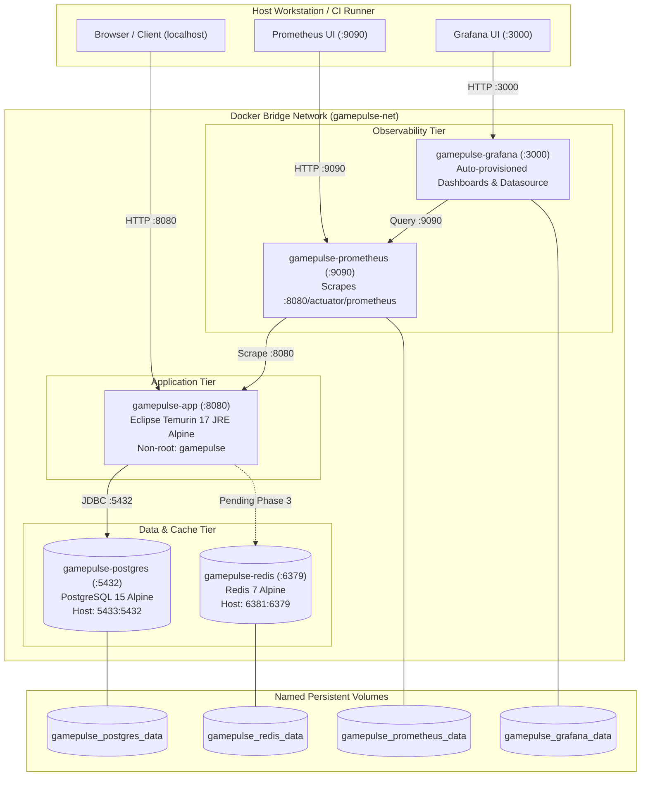

# GamePulse — System Architecture & Technical Specification

> **Persistent Technical Context**  
> **Package Standard**: `com.gamepulse.*`  
> **Architectural Pattern**: Modular Monolith with Domain-Driven Invariant Boundaries

---

## 1. Domain Partitioning & Module Structure

GamePulse is implemented as an in-process modular monolith. Explicit package boundaries separate domain logic from cross-cutting concerns:

```
src/main/java/com/gamepulse/
├── GamePulseApplication.java                  # Application Bootstrap & Configuration
├── core/                                      # Cross-cutting infrastructure
│   ├── controller/SystemInfoController.java   # Service metadata & version endpoint
│   ├── exception/                             # RFC 7807 problem details & hierarchy
│   ├── filter/CorrelationIdFilter.java        # MDC logging & X-Correlation-Id tracking
│   └── idempotency/                           # Application-level idempotency engine
│       ├── dto/IdempotencyResult.java
│       ├── filter/CachedBodyHttpServletRequest.java
│       ├── filter/IdempotencyFilter.java
│       ├── model/IdempotencyRecord.java & IdempotencyStatus.java
│       ├── repository/IdempotencyRecordRepository.java
│       └── service/IdempotencyService.java
├── player/                                    # Player identity & MMR domain
│   ├── controller/PlayerController.java
│   ├── dto/CreatePlayerRequest.java & PlayerResponse.java
│   ├── model/Player.java & PlayerStatus.java
│   ├── repository/PlayerRepository.java
│   └── service/PlayerService.java
├── matchmaking/                               # Matchmaking queue & matching engine
│   ├── controller/MatchmakingController.java
│   ├── dto/EnqueueRequest.java & MatchmakingTicketResponse.java
│   ├── model/MatchmakingTicket.java & TicketStatus.java
│   ├── repository/MatchmakingTicketRepository.java
│   └── service/MatchmakingService.java
└── session/                                   # Lobby & match lifecycle domain
    ├── controller/MatchSessionController.java
    ├── dto/CreateLobbyRequest.java, JoinLobbyRequest.java, MatchSessionResponse.java
    ├── model/MatchSession.java, MatchSessionPlayer.java, MatchStatus.java
    ├── repository/MatchSessionRepository.java, MatchSessionPlayerRepository.java
    └── service/MatchSessionService.java
```

---

## 2. End-to-End Request Pipeline

```mermaid
sequenceDiagram
    autonumber
    actor Client as Game Client / Tester
    participant CorrFilter as CorrelationIdFilter
    participant IdemFilter as IdempotencyFilter
    participant Controller as REST Controller
    participant Service as Domain Service
    participant DB as PostgreSQL / H2
    
    Client->>CorrFilter: HTTP Request (Optional X-Correlation-Id, Idempotency-Key)
    Note over CorrFilter: Extract or generate UUID;<br/>Populate SLF4J MDC
    CorrFilter->>IdemFilter: Wrapped Request
    
    alt Request is Mutating (POST/PUT/PATCH/DELETE) and has Idempotency-Key
        Note over IdemFilter: Compute SHA-256(Body)
        IdemFilter->>DB: Query IdempotencyRecord by Key
        alt Previous Request COMPLETED with identical hash
            IdemFilter-->>Client: Replay cached HTTP response (Idempotency-Replayed: true)
        else In-Flight request exists (IN_PROGRESS)
            IdemFilter-->>Client: Reject with 409 Conflict (CONCURRENT_REQUEST_IN_FLIGHT)
        else Key reused with mismatched hash
            IdemFilter-->>Client: Reject with 409 Conflict (IDEMPOTENCY_KEY_PAYLOAD_MISMATCH)
        else First execution
            IdemFilter->>DB: Insert IdempotencyRecord (IN_PROGRESS, REQUIRES_NEW)
            IdemFilter->>Controller: Dispatch request
            Controller->>Service: Execute business logic (@Transactional)
            Service->>DB: Authoritative Read/Write with Locks
            DB-->>Service: Updated State
            Service-->>Controller: DTO Response
            Controller-->>IdemFilter: Response (2xx/3xx)
            IdemFilter->>DB: Update IdempotencyRecord (COMPLETED, body, status)
            IdemFilter-->>Client: HTTP Response
        end
    else Non-mutating (GET) or no Idempotency-Key
        IdemFilter->>Controller: Direct dispatch
        Controller->>Service: Execute business logic
        Service->>DB: Query
        DB-->>Service: Result
        Service-->>Controller: Response
        Controller-->>Client: HTTP Response
    end
```

---

## 3. Database Schema & Constraints

Authoritative persistence is managed via Spring Data JPA and Hibernate. Key tables and constraints:

### `players` Table
- `id` (UUID, Primary Key)
- `username` (VARCHAR(30), Unique, Not Null)
- `email` (VARCHAR(100), Unique, Not Null)
- `mmr` (INTEGER, Not Null, Default 1200)
- `status` (VARCHAR(20), Enum: `ONLINE`, `IN_QUEUE`, `IN_MATCH`, `OFFLINE`)
- `version` (BIGINT, Optimistic lock `@Version`)
- `created_at`, `updated_at` (TIMESTAMP WITH TIME ZONE)

### `matchmaking_tickets` Table
- `id` (UUID, Primary Key)
- `player_id` (UUID, Foreign Key $\rightarrow$ `players.id`, Index)
- `mmr` (INTEGER, Not Null)
- `status` (VARCHAR(20), Enum: `QUEUED`, `MATCHED`, `CANCELLED`, `EXPIRED`, Index)
- `match_id` (UUID, Nullable)
- `version` (BIGINT, `@Version`)
- `enqueued_at`, `matched_at`, `cancelled_at` (TIMESTAMP WITH TIME ZONE)

### `match_sessions` Table
- `id` (UUID, Primary Key)
- `title` (VARCHAR(100), Not Null)
- `game_mode` (VARCHAR(50), Not Null)
- `status` (VARCHAR(30), Enum: `INITIALIZING`, `WAITING_FOR_PLAYERS`, `IN_PROGRESS`, `COMPLETED`, `CANCELLED`, Index)
- `max_players` (INTEGER, Not Null)
- `winner_id` (UUID, Nullable)
- `winning_team` (INTEGER, Nullable)
- `version` (BIGINT, `@Version`)
- `created_at`, `updated_at` (TIMESTAMP WITH TIME ZONE)

### `match_session_players` Table
- `id` (UUID, Primary Key)
- `match_session_id` (UUID, Foreign Key $\rightarrow$ `match_sessions.id`, Not Null)
- `player_id` (UUID, Foreign Key $\rightarrow$ `players.id`, Not Null)
- `team` (INTEGER, Not Null)
- `joined_at` (TIMESTAMP WITH TIME ZONE, Not Null)
- **Constraint**: Composite Unique Constraint `(match_session_id, player_id)` prevents double-joining.

### `idempotency_records` Table
- `id` (UUID, Primary Key)
- `idempotency_key` (VARCHAR(128), Unique Index, Not Null)
- `request_path` (VARCHAR(255), Not Null)
- `request_hash` (VARCHAR(64), SHA-256 hash of payload, Not Null)
- `status` (VARCHAR(20), Enum: `IN_PROGRESS`, `COMPLETED`, `FAILED`, Not Null)
- `response_status` (INTEGER, Nullable)
- `response_body` (TEXT, Nullable)
- `response_headers` (TEXT, Serialized JSON, Nullable)
- `created_at`, `expires_at` (TIMESTAMP WITH TIME ZONE, Index on `expires_at` for TTL cleanup)

---

## 4. Concurrency & Locking Strategy

GamePulse applies defense-in-depth concurrency control:

```
Contention Level        Locking Mechanism                           Enforced Invariant
High (Lobby Slots)  --> PESSIMISTIC_WRITE (SELECT ... FOR UPDATE) --> Capacity is strictly bounded (size <= maxPlayers)
High (Queue Entry)  --> PESSIMISTIC_WRITE (Player Row Lock)      --> Max 1 active QUEUED ticket per player
High (Match Sweep)  --> PESSIMISTIC_WRITE (Multi-Ticket Lock)    --> Tickets cannot be matched twice
Unintended Updates  --> Optimistic Locking (@Version)            --> Detects concurrent stale writes
Database Defense    --> Composite Unique Constraints             --> Prevents duplicate roster entries at storage layer
```

1. **Lobby Capacity**: When a player joins a lobby, `MatchSessionRepository.findByIdWithLock(sessionId)` acquires an exclusive row-level lock. All other concurrent joins queue behind this transaction, ensuring the check `players.size() < session.getMaxPlayers()` evaluates monotonically.
2. **Deterministic Matchmaking Evaluation**:
   - `MatchmakingService.evaluateMatches()` iterates over waiting tickets ordered by `enqueuedAt ASC`.
   - Dynamic MMR tolerance window: $\Delta_{\text{MMR}} = \text{baseTolerance} + (\text{waitSeconds} \times \text{expansionRate})$.
   - When candidate tickets $T_1$ and $T_2$ satisfy mutual MMR tolerance, the service calls `findByIdsWithLock(List.of(T_1.id, T_2.id))` to lock both rows.
   - Re-verifies both are still `QUEUED` before instantiating the match session. If another thread claimed either, the pair is safely skipped.

---

## 5. Match Session State Machine



- Invalid transitions (e.g., trying to cancel a `COMPLETED` match, or starting a `CANCELLED` match) throw `InvalidStateTransitionException` which maps to RFC 7807 `409 Conflict`.

---

## 6. Observability & Telemetry

- **Correlation ID Tracking**: `CorrelationIdFilter` inspects `X-Correlation-Id` header (or generates UUID). Injects into SLF4J MDC context (`%X{correlationId}`) and mirrors in HTTP response header.
- **Actuator Health**: Configured with liveness and readiness probes (`management.endpoint.health.probes.enabled=true`).
- **Prometheus Scraping**: Standard Micrometer Prometheus exporter at `/actuator/prometheus`.
- **OpenAPI 3.0 Documentation**: Generated by SpringDoc OpenAPI Starter WebMVC UI at `/v3/api-docs` and `/swagger-ui.html`.

---

## 7. Container & Infrastructure Topology (Phase 6)

GamePulse encapsulates its full development runtime into an isolated, orchestrated Docker Compose environment:



### Key Infrastructure Decisions:
1. **Multi-Stage Build Pattern**: `Dockerfile` uses `maven:3.9-eclipse-temurin-17-alpine` as builder with layer-cached `pom.xml` dependencies, and copies only the fat jar into a minimal `eclipse-temurin:17-jre-alpine` runtime.
2. **Hardened Runtime**: Runs as non-root system user `gamepulse:gamepulse`, installs `curl` exclusively for container healthchecks, and sizes JVM heap using container cgroup memory limits (`-XX:+UseContainerSupport -XX:MaxRAMPercentage=75.0`).
3. **Collision-Proof Host Port Mapping**: Maps PostgreSQL to host port `5433` and Redis to host port `6381` by default via `.env.example`, eliminating port collision errors with local databases. Internal container networking communicates over standard DNS ports (`postgres:5432`, `redis:6379`).
4. **Health-Check Driven Startup Dependency**: `gamepulse-app` startup blocks until both PostgreSQL and Redis pass active readiness probes.


