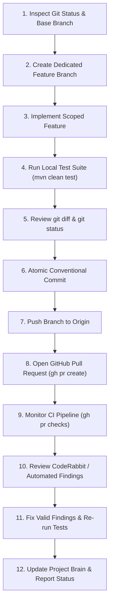

# GamePulse — GitHub Collaboration & Delivery Workflow

> **Mandatory Collaboration Protocol**  
> **Rule**: Every distinct implementation phase must have its own dedicated feature branch and GitHub PR. Never commit directly to `main`, never force-push, never rewrite published history, and never merge a PR automatically without explicit authorization.

---

## 1. Standard Phased Delivery Cycle



---

## 2. Step-by-Step Rules of Engagement

### Step 1: Pre-Implementation Verification
- Execute `git status`, `git branch -v`, and `git fetch origin main`.
- Confirm local `main` is identical to `origin/main`.
- If uncommitted changes exist, preserve them safely. Do not discard or reset uncommitted user files.

### Step 2: Branch Creation
- Branch names must be concise, descriptive, and prefixed with standard category tags:
  - `feat/<feature-name>` (e.g. `feat/docker-infrastructure`, `feat/redis-resilience`)
  - `refactor/<refactor-scope>` (e.g. `refactor/standardize-package-namespace`)
  - `docs/<doc-scope>` (e.g. `docs/enhanced-readme`)
  - `test/<test-scope>` (e.g. `test/concurrency-benchmarks`)
- Always branch directly from the updated default branch (`main`).
- Avoid awkward, overly long, or vendor-referencing branch names.

### Step 3: Incremental Implementation
- Keep edits tightly scoped to the active phase.
- Do not mix multiple unrelated features into a single branch.

### Step 4: Local Test Verification
- Run the full test suite before committing:
  ```bash
  ./mvnw clean test
  ```
- Any compilation error, test failure, or regression must be resolved before proceeding.

### Step 5: Diff Review
- Review staged changes: `git status` and `git diff`.
- Check that:
  - Zero accidental files, IDE configs, `.env` files, or secrets are tracked.
  - Line endings and encodings (UTF-8 without BOM) are clean.
  - Package statements and imports are uniform.

### Step 6: Professional Conventional Commits
- Commit messages must follow conventional commit standards and read like a human senior software engineer:
  - `feat(idempotency): implement request idempotency and cache`
  - `feat(concurrency): add pessimistic locking and capacity checks`
  - `test: add concurrency and idempotency integration test suites`
  - `docs: update tracking table with PR #4 merge status`
- Keep commit headlines concise ($\le 60$ characters). Avoid bloated or multi-sentence commit titles.

### Step 7: Push to Origin
- Push to the configured remote origin:
  ```bash
  git push -u origin <branch-name>
  ```
- Verify the push succeeded before attempting to open a PR.

### Step 8: Open Pull Request
- Use GitHub CLI (`gh pr create`):
  ```bash
  gh pr create --base main --head <branch-name> --title "<title>" --body "<body>"
  ```
- Provide an engineering-focused PR description summarizing:
  - Motivation and architectural design decisions.
  - Implemented changes and invariants.
  - Test evidence (test counts, pass/fail results, race condition results).

### Step 9: CI Pipeline Quality Gate
- Monitor GitHub Actions workflow status:
  ```bash
  gh pr checks <pr-number>
  ```
- The CI pipeline must achieve `pass` (`success`). If a check fails, inspect runner logs and apply fixes immediately.

### Step 10: Code Review & Findings Resolution
- Inspect CodeRabbit comments and findings:
  ```bash
  gh pr view <pr-number> --comments
  ```
- Address valid critical or high-severity issues on the same feature branch, re-run affected tests, and push the updates.

### Step 11: Brain & State Maintenance
- After every milestone, update `project-brain/CURRENT_STATE.md`, `project-brain/IMPLEMENTATION_LEDGER.md`, `project-brain/ROADMAP.md`, and `project-brain/SESSION_HANDOFF.md`.

---

## 3. Strict Prohibitions

1. **NO FORCE PUSHING**: Never run `git push --force` or `--force-with-lease` on public or shared branches.
2. **NO HISTORY REWRITING**: Do not rebase published remote commits without explicit user instruction.
3. **NO AUTOMATIC MERGING**: Do not merge PRs without the user's explicit instruction or approval.
4. **NO CREDENTIAL COMMITS**: Never commit passwords, tokens, API keys, or private certificates.
5. **NO FABRICATION**: Never report a PR as created, pushed, or merged unless verified via CLI.

