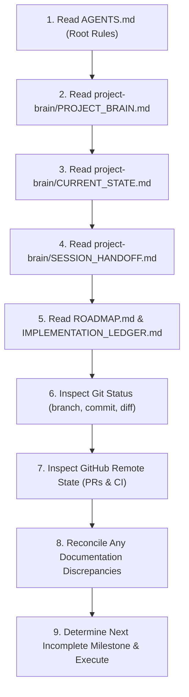

# GamePulse — Persistent Project Brain (Master Entry Point)

> **CRITICAL DIRECTIVE FOR ALL AI AGENTS**:  
> Read this document and [`AGENTS.md`](../AGENTS.md) first upon starting any new conversation or session. The Git repository is the persistent source of truth. Chat history is transient. Do not assume earlier conversation reports are current without verifying against actual repository files, tests, and Git status.

---

## 1. Project Identity

- **Project Name**: GamePulse
- **Repository**: [https://github.com/rohith-chitturi/GamePulse](https://github.com/rohith-chitturi/GamePulse)
- **Primary Objective**: Deliver a production-minded, distributed gameplay services platform built with Java 17 and Spring Boot 3 demonstrating backend correctness, data integrity, concurrency controls, automated testing, CI/CD, observability, and reliability engineering.
- **Project Context & Identity**: Independent software engineering portfolio project for Software Engineering / DevOps internship demonstrations. This is **not** an official Electronic Arts product, internal tool, or sponsored project.
- **Target Audience**: Software engineering recruiters, backend architects, SRE/DevOps engineers, and technical interviewers.
- **Target Runtime**: Java 17 LTS, Spring Boot 3.3.5, PostgreSQL 15, Spring Data JPA / Hibernate 6, embedded H2 (local development mode).

---

## 2. Core Engineering Principles

1. **Correctness Before Feature Count**: A robust, concurrency-tested subset of features is infinitely more valuable than an unstable collection of unverified microservices.
2. **Verify Before Claiming Completion**: Every claim of completion must be backed by executed commands, passing tests, and verified repository diffs.
3. **Reuse Working Implementation**: Never rebuild or throw away existing, tested working code. Inspect the repository before writing new classes.
4. **Inspect Existing Code First**: Understand transaction boundaries, entity versions, locking modes, and package structures before modifying modules.
5. **Keep Changes Small & Scoped**: Make atomic, reviewable commits that solve single problems with corresponding test coverage.
6. **Preserve User Changes & Git History**: Never force-push, rewrite published history, delete user branches, or discard unstaged work without explicit authorization.
7. **Zero Fabrication**: Never fabricate test results, benchmark numbers, terminal logs, PR URLs, review approvals, or deployment statuses.
8. **Explicit Capability Separation**: Strictly distinguish what is *Implemented & Verified* from what is *Configured* or *Planned*.
9. **Document Architectural Decisions**: Record the trade-offs and reasoning for technology and pattern choices in [DECISIONS.md](DECISIONS.md).
10. **Strict PR Workflow**: Every distinct phase must be completed through a dedicated feature branch, verified CI quality gate, and GitHub PR.
11. **Continuous Brain Maintenance**: Update the implementation ledger, current state, roadmap, and session handoff after every substantial milestone.
12. **Tone & Collaboration**: All git commit messages, PR descriptions, and repository documentation must read naturally as a human senior software engineer (no bot/agent language).

---

## 3. Mandatory Session Startup Procedure

Whenever a new conversation or session begins, execute this sequence before writing code:

1. **Read `AGENTS.md`**: Immediate rules of engagement.
2. **Read `project-brain/PROJECT_BRAIN.md`**: Context, scope, and index.
3. **Read `project-brain/CURRENT_STATE.md`**: Current snapshot of branches, commits, PRs, and verified tests.
4. **Read `project-brain/SESSION_HANDOFF.md`**: Exact instructions left by the previous session.
5. **Read `project-brain/ROADMAP.md` & `IMPLEMENTATION_LEDGER.md`**: Status of all functional modules.
6. **Inspect Git Status**: Execute `git status`, `git branch -v`, `git log -n 5 --oneline` to establish local reality.
7. **Inspect GitHub State**: Execute `gh pr list --state all` and `gh run list -L 3` to verify remote status.
8. **Reconcile Discrepancies**: If repository evidence conflicts with earlier chat summaries, update the persistent documents to reflect repository ground truth.
9. **Execute Next Task**: Pick up the exact task defined in the handoff.

---

## 4. Master Brain Document Index

| Document | Purpose | Primary Audience |
| :--- | :--- | :--- |
| **[CURRENT_STATE.md](CURRENT_STATE.md)** | Single source of current progress, active branch, and test evidence | Every new session |
| **[SESSION_HANDOFF.md](SESSION_HANDOFF.md)** | Concrete instructions to resume work without losing progress | Every new session |
| **[IMPLEMENTATION_LEDGER.md](IMPLEMENTATION_LEDGER.md)** | Granular feature-by-feature implementation and verification ledger | Planning & coding |
| **[ARCHITECTURE.md](ARCHITECTURE.md)** | Modular monolith design, package hierarchy, state machines, and data flow | Coding & design |
| **[DECISIONS.md](DECISIONS.md)** | Architectural Decision Records (ADRs) with rationale and trade-offs | Architectural review |
| **[TESTING_AND_CI.md](TESTING_AND_CI.md)** | Test suite catalog, execution commands, coverage, and CI quality gates | Testing & QA |
| **[GITHUB_WORKFLOW.md](GITHUB_WORKFLOW.md)** | Branching strategies, PR protocols, commit styles, and review criteria | Delivery & DevOps |
| **[ROADMAP.md](ROADMAP.md)** | Phased engineering execution plan and completion criteria | Project tracking |
| **[KNOWN_ISSUES.md](KNOWN_ISSUES.md)** | Troubleshooting ledger, environmental constraints, and workarounds | Debugging & SRE |
| **[HISTORY.md](HISTORY.md)** | Chronological record of completed milestones, PRs, and commits | Portfolio audit |

